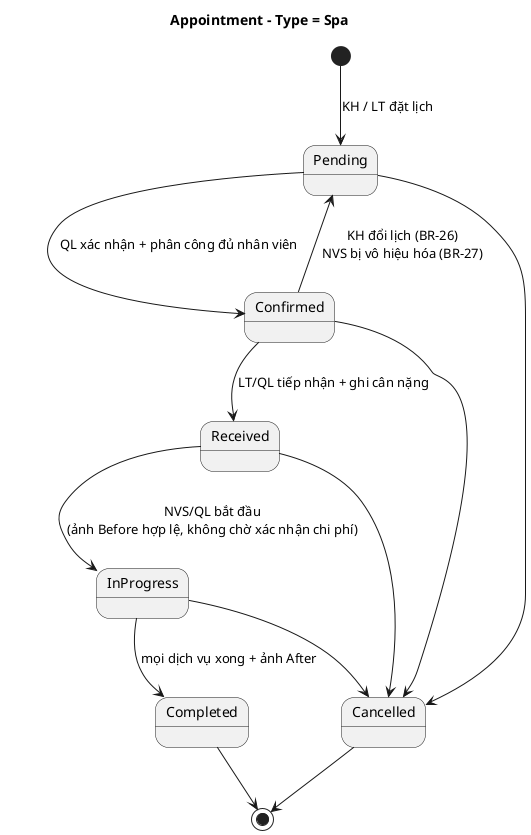
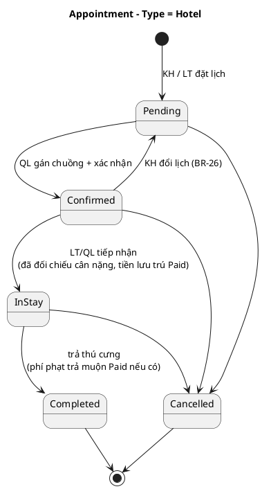
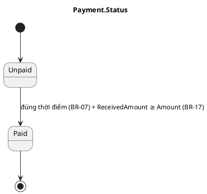

# Thiết kế cơ sở dữ liệu – Hệ thống quản lý spa thú cưng

> **Nguồn:** *Requirements & Business Analysis v2* (viết tắt **Req**) và *System Analysis & UI Design v1.3* (viết tắt **SA**). Khi hai tài liệu khác nhau, theo SA v1.3.
> **Ký hiệu cột:** `PK` khóa chính · `FK→` khóa ngoại · `UQ` duy nhất · `NN` không null · `CK` ràng buộc kiểm tra · `NULL` cho phép null.
> **Nhãn:** **(Đề xuất)** quyết định thiết kế của SA chưa có trong Req · **(Bổ sung)** ngoài Req v2, theo yêu cầu nhóm.
> **Viết tắt vai trò:** KH khách hàng · LT lễ tân · NVS nhân viên spa · QL quản lý. `UC-xx`, `FR-xxx`, `BR-xx` là mã use case, yêu cầu chức năng, quy tắc nghiệp vụ trong SA/Req.

---

## 1. Tổng quan

Hệ thống phục vụ **một cửa hàng** spa thú cưng (chó, mèo, thỏ, chuột lang) với hai loại dịch vụ: **spa** (theo khung giờ, cần 1–2 nhân viên) và **lưu trú** (theo đêm, 1 chuồng). CSDL là **PostgreSQL (Supabase)**; chỉ backend truy cập CSDL.

### 1.1 Quy ước

| Hạng mục | Quy ước |
| --- | --- |
| Khóa chính | Dạng `uuid`; bảng liên kết dùng khóa kép; 4 bảng tham chiếu (`SizeRule`, `WeightTolerance`, `HotelPricing`, `SystemConfig`) dùng khóa tự nhiên |
| Thời gian | `timestamptz`, lưu UTC, hiển thị theo múi giờ cửa hàng (đề xuất `Asia/Ho_Chi_Minh`) |
| Tiền | `numeric(12,0)`, đơn vị VND |
| "Đêm" lưu trú | Quy theo múi giờ cửa hàng |
| Enum | Lưu `varchar` + `CK`, giá trị bằng tiếng Anh (ví dụ `Pending`) |
| Dữ liệu do hệ thống quyết định | `Role`, `SizeGroup`, `Status`, `Amount`, nhân viên phụ trách, chuồng được gán do backend xác định, không nhận từ client (QL chỉ chọn nhân viên/chuồng khi xác nhận lịch) |
| Extension | `btree_gist` (cho ràng buộc loại trừ) **(Đề xuất)** |

### 1.2 Nhóm bảng (21 bảng)

| Nhóm | Bảng |
| --- | --- |
| Tài khoản & con người | `AppUser`, `RefreshToken`, `Customer`, `Staff` |
| Thú cưng & quy tắc kích cỡ | `Pet`, `SizeRule`, `WeightTolerance` |
| Danh mục spa | `Service`, `ServicePricing` |
| Lưu trú | `Cage`, `HotelPricing` |
| Lịch hẹn | `Appointment`, `AppointmentStaff`, `AppointmentService`, `CostConfirmation`, `AppointmentPhoto` |
| Lịch làm việc **(Bổ sung)** | `WorkShift` |
| Thanh toán | `Payment`, `PaymentTransaction` |
| Thông báo & cấu hình | `Notification`, `SystemConfig` **(Bổ sung)** |

### 1.3 Quyết định thiết kế chính

| Quyết định | Lý do |
| --- | --- |
| Spa và lưu trú **dùng chung bảng `Appointment`**, phân biệt bằng `Type`; cột riêng của loại kia để NULL | Chung vòng đời, thanh toán, thông báo, phân quyền (FR-LFC-01); ràng buộc loại trừ cần `Status` và thời gian cùng bảng |
| Khách vãng lai = `Customer` có `UserId = NULL` | Vẫn gắn được thú cưng và lịch hẹn (BR-01) nhưng không đăng nhập, không nhận thông báo |
| Số điện thoại là định danh duy nhất: `AppUser.UserName` = `Customer.Phone` khi có tài khoản (X-02) | Chống trùng (FR-ACC-01, FR-ACC-04); đổi số phải cập nhật cả hai trong một giao dịch |
| `ServicePricing(ServiceId, Species, SizeGroup)` mang **giá, thời lượng, số nhân viên** | Dịch vụ áp dụng cho loài nào thì có dòng của loài đó (BR-11, BR-12) |
| Giá spa **không lưu** ở `AppointmentService`; `Payment.Amount` tính khi đến thời điểm ghi nhận | FR-PAY-01 dùng đơn giá hiện có và nhóm kích cỡ đã đối chiếu tại thời điểm ghi nhận; vì không lưu giá lúc đặt nên thay đổi giá có hiệu lực ngay cả với lịch hẹn chưa thanh toán; `SlotEnd`, `BusyUntil`, `StaffRequired` được chốt lúc đặt |
| `SlotEnd`, `BusyUntil`, `StaffRequired` **chốt lúc đặt**; không đổi khi đổi nhóm kích cỡ lúc tiếp nhận | Đổi cấu hình hoặc nhóm kích cỡ không làm sai lịch đã đặt (BR-23, X-10) |
| `BusyFrom`/`BusyUntil` được **sao chép** sang `AppointmentStaff` | Ràng buộc chống trùng nhân viên (BR-04) đặt ngay trên bảng này |
| Quay về `Pending` thì **xóa `AppointmentStaff` và `CageId`** (Đề xuất); `AppointmentStaff` được giữ lại sau khi xong | Giải phóng nhân viên/chuồng để đề xuất lại (BR-26, BR-27); làm lịch sử công việc (FR-EXE-06) |
| Bảng mốc kích cỡ, dung sai, tham số là **dữ liệu** (`SizeRule`, `WeightTolerance`, `SystemConfig`) | BR-19, BR-23 quy định "cấu hình được"; có hiệu lực ngay, không cần triển khai lại (FR-CFG-01) |
| Không có trạng thái hoàn tiền | Hoàn tiền xử lý ngoài hệ thống (BR-24) |

---

## 2. Sơ đồ thực thể liên kết (ERD)

ERD chỉ hiển thị khóa và cột chính; đầy đủ cột ở mục 3. `SizeRule`, `WeightTolerance`, `HotelPricing`, `SystemConfig` là bảng tham chiếu, **không có FK**, liên kết logic qua giá trị `Species`/`SizeGroup`.

```plantuml
@startuml ERD_SpaThuCung
hide circle
skinparam linetype ortho

package "Tài khoản" {
  entity AppUser {
    * UserId : uuid <<PK>>
    --
    UserName : varchar(20) <<UQ>>
    Role : Customer|Staff|Manager
    IsActive : boolean
  }
  entity RefreshToken {
    * TokenId : uuid <<PK>>
    --
    UserId : uuid <<FK>>
    TokenHash : text <<UQ>>
    RevokedAt : timestamptz
  }
  entity Customer {
    * CustomerId : uuid <<PK>>
    --
    UserId : uuid <<FK, UQ, NULL>>
    Phone : varchar(20) <<UQ>>
    IsBookingLocked : boolean
  }
  entity Staff {
    * StaffId : uuid <<PK>>
    --
    UserId : uuid <<FK, UQ>>
    StaffRole : Receptionist|SpaStaff
  }
}

package "Lịch làm việc" {
  entity WorkShift {
    * ShiftId : uuid <<PK>>
    --
    StaffId : uuid <<FK>>
    ShiftStart, ShiftEnd
  }
}

package "Thú cưng & danh mục" {
  entity Pet {
    * PetId : uuid <<PK>>
    --
    CustomerId : uuid <<FK>>
    Species, Temperament
    WeightKg, HeightCm
    SizeGroup, IsActive
  }
  entity Service {
    * ServiceId : uuid <<PK>>
    --
    LatestStartTime : time
    IsActive : boolean
  }
  entity ServicePricing {
    * ServiceId : uuid <<PK, FK>>
    * Species <<PK>>
    * SizeGroup <<PK>>
    --
    Price, DurationMinutes, StaffRequired
  }
  entity Cage {
    * CageId : uuid <<PK>>
    --
    Code : varchar(20) <<UQ>>
    Species, SizeGroup, IsActive
  }
}

package "Lịch hẹn" {
  entity Appointment {
    * AppointmentId : uuid <<PK>>
    --
    Type : Spa|Hotel
    CustomerId : uuid <<FK>>
    PetId : uuid <<FK>>
    CageId : uuid <<FK, NULL>>
    Status, CancelReason, SizeGroup
    SlotStart, SlotEnd, BusyUntil, StaffRequired
    PlannedCheckIn, PlannedCheckOut, ActualCheckOut
  }
  entity AppointmentStaff {
    * AppointmentId : uuid <<PK, FK>>
    * StaffId : uuid <<PK, FK>>
    --
    BusyFrom, BusyUntil, IsHolding
  }
  entity AppointmentService {
    * AppointmentId : uuid <<PK, FK>>
    * ServiceId : uuid <<PK, FK>>
    --
    IsDone, DoneAt, Note
  }
  entity CostConfirmation {
    * ConfirmationId : uuid <<PK>>
    --
    AppointmentId : uuid <<FK>>
    RespondedByUserId : uuid <<FK, NULL>>
    Status, ExpiresAt
  }
  entity AppointmentPhoto {
    * PhotoId : uuid <<PK>>
    --
    AppointmentId : uuid <<FK>>
    UploadedByStaffId : uuid <<FK>>
    Kind : Before|After
  }
}

package "Thanh toán & thông báo" {
  entity Payment {
    * PaymentId : uuid <<PK>>
    --
    AppointmentId : uuid <<FK>>
    ConfirmedByUserId : uuid <<FK, NULL>>
    Kind : Spa|Stay|LateFee
    Status : Unpaid|Paid
  }
  entity PaymentTransaction {
    * TxnId : uuid <<PK>>
    --
    PaymentId : uuid <<FK>>
    TxnRef : varchar(64) <<UQ>>
  }
  entity Notification {
    * NotificationId : uuid <<PK>>
    --
    RecipientUserId : uuid <<FK>>
    AppointmentId : uuid <<FK, NULL>>
    IsRead : boolean
  }
}

package "Bảng tham chiếu (không FK)" {
  entity SizeRule {
    * Species <<PK>>
    * Criterion <<PK>>
    --
    SmallUpper, MediumUpper
  }
  entity WeightTolerance {
    * Species <<PK>>
    * FromGroup <<PK>>
    * ToGroup <<PK>>
    --
    ToleranceKg
  }
  entity HotelPricing {
    * Species <<PK>>
    * SizeGroup <<PK>>
    --
    PricePerNight, FoodPerNight
  }
  entity SystemConfig {
    * ConfigKey : varchar(100) <<PK>>
    --
    ConfigValue
  }
}

AppUser |o--o| Customer : "UserId (NULL = vãng lai)"
AppUser ||--o| Staff
AppUser ||--o{ RefreshToken
AppUser ||--o{ Notification
Staff ||--o{ WorkShift
Customer ||--o{ Pet
Customer ||--o{ Appointment
Pet ||--o{ Appointment
Cage |o--o{ Appointment : "CageId (Hotel)"
Service ||--|{ ServicePricing
Service ||--o{ AppointmentService
Appointment ||--o{ AppointmentService
Appointment ||--o{ AppointmentStaff
Staff ||--o{ AppointmentStaff
Appointment ||--o{ CostConfirmation
Appointment ||--o{ AppointmentPhoto
Staff ||--o{ AppointmentPhoto
Appointment ||--o{ Payment
Payment ||--o{ PaymentTransaction
Appointment |o--o{ Notification
AppUser |o--o{ CostConfirmation : "RespondedByUserId"
AppUser |o--o{ Payment : "ConfirmedByUserId"
@enduml
```



### Giải thích quan hệ

| Quan hệ (cha → con) | Số lượng | Ý nghĩa nghiệp vụ |
| --- | --- | --- |
| `AppUser` → `Customer` | 1 – 0..1 | Khách có tài khoản; vãng lai không có `AppUser` |
| `AppUser` → `Staff` | 1 – 0..1 | Nhân viên (lễ tân/nhân viên spa). Quản lý chỉ có `AppUser` (Role = Manager) |
| `Customer` → `Pet` | 1 – 0..* | Mỗi thú cưng thuộc đúng một khách hàng |
| `Customer`, `Pet` → `Appointment` | 1 – 0..* | Mỗi lịch hẹn gắn một khách hàng và đúng một thú cưng (BR-01, BR-02) |
| `Service` → `ServicePricing` | 1 – 1..* | Giá, thời lượng, số nhân viên theo (loài, nhóm kích cỡ) |
| `Appointment` ↔ `Service` qua `AppointmentService` | n – n | Lịch spa gồm ≥ 1 dịch vụ; theo dõi hoàn thành từng dịch vụ (BR-06) |
| `Appointment` ↔ `Staff` qua `AppointmentStaff` | n – n | Lịch spa cần 1–2 nhân viên; nhân viên làm nhiều lịch (BR-04, X-10) |
| `Cage` → `Appointment` | 0..1 – 0..* | Lịch lưu trú được gán 1 chuồng; một chuồng không trùng đêm (BR-21) |
| `Appointment` → `CostConfirmation` | 1 – 0..* | Yêu cầu khách xác nhận chi phí mới (BR-23); tối đa 1 yêu cầu `Pending` mỗi lịch |
| `Appointment` → `AppointmentPhoto` | 1 – 0..* | Ảnh trước/sau của lịch spa (BR-20) |
| `Appointment` → `Payment` | 1 – 0..* | Spa: 1 khoản; lưu trú: tối đa 2 khoản (`Stay`, `LateFee`) (BR-22) |
| `Payment` → `PaymentTransaction` | 1 – 0..* | Giao dịch qua cổng VNPAY/MoMo (khởi tạo + callback) |
| `AppUser` → `Notification` | 1 – 0..* | Chỉ người có tài khoản nhận thông báo |
| `Staff` → `WorkShift` | 1 – 0..* | Ca làm của nhân viên spa, căn cứ tính số nhân viên khả dụng (BR-13) |

---

## 3. Đặc tả bảng

### 3.1 Tài khoản & con người

**`AppUser`** – Tài khoản đăng nhập (ánh xạ ASP.NET Core Identity). Khách vãng lai không có bản ghi ở đây.

| Cột | Kiểu | Ràng buộc | Ý nghĩa |
| --- | --- | --- | --- |
| UserId | uuid | PK | Mã tài khoản |
| UserName | varchar(20) | UQ, NN | Số điện thoại đã chuẩn hóa; định danh đăng nhập mọi vai trò |
| PasswordHash | text | NN | Băm bằng PasswordHasher; không bao giờ trả ra response |
| Role | varchar(20) | NN, CK `Customer`\|`Staff`\|`Manager` | Lấy từ token, không nhận từ client |
| IsActive | boolean | NN, mặc định true | false = từ chối đăng nhập và làm mới token (FR-STF-03) |
| CreatedAt | timestamptz | NN | Thời điểm tạo |

**`RefreshToken`** – Refresh token lưu dạng băm để thu hồi được.

| Cột | Kiểu | Ràng buộc | Ý nghĩa |
| --- | --- | --- | --- |
| TokenId | uuid | PK | Mã bản ghi |
| UserId | uuid | FK→AppUser, NN | Chủ sở hữu token |
| TokenHash | text | UQ, NN | Giá trị băm, không lưu token thô |
| ExpiresAt | timestamptz | NN | Hết hạn |
| RevokedAt | timestamptz | NULL | Có giá trị = đã thu hồi (đăng xuất, tài khoản bị vô hiệu hóa) |
| CreatedAt | timestamptz | NN | Thời điểm cấp |

**`Customer`** – Khách hàng có tài khoản hoặc khách vãng lai.

| Cột | Kiểu | Ràng buộc | Ý nghĩa |
| --- | --- | --- | --- |
| CustomerId | uuid | PK | Mã khách hàng |
| UserId | uuid | FK→AppUser, UQ, NULL | NULL = khách vãng lai |
| FullName | varchar(150) | NN | Họ tên |
| Phone | varchar(20) | UQ, NN | Thông tin liên hệ duy nhất; khách có tài khoản thì bằng `AppUser.UserName` |
| Email | varchar(150) | NULL | Tùy chọn |
| IsBookingLocked | boolean | NN, mặc định false | true = bị khóa tự đặt lịch trực tuyến (BR-15); không áp dụng khi LT đặt thay |
| CreatedAt | timestamptz | NN | Thời điểm tạo |

**`Staff`** – Hồ sơ nhân viên. Số điện thoại là `AppUser.UserName`, trạng thái hoạt động là `AppUser.IsActive`.

| Cột | Kiểu | Ràng buộc | Ý nghĩa |
| --- | --- | --- | --- |
| StaffId | uuid | PK | Mã nhân viên |
| UserId | uuid | FK→AppUser, UQ, NN | Tài khoản đăng nhập của nhân viên |
| FullName | varchar(150) | NN | Họ tên |
| StaffRole | varchar(20) | NN, CK `Receptionist`\|`SpaStaff` | Lễ tân / nhân viên spa, do QL chọn (FR-STF-01) |

**`WorkShift`** **(Bổ sung, X-01)** – Ca làm việc của nhân viên spa do QL phân lịch (FR-STF-04).

| Cột | Kiểu | Ràng buộc | Ý nghĩa |
| --- | --- | --- | --- |
| ShiftId | uuid | PK | Mã ca |
| StaffId | uuid | FK→Staff, NN | Nhân viên spa đang hoạt động; nhân viên đã vô hiệu hóa không được thêm ca (UC-35) |
| ShiftStart | timestamptz | NN | Bắt đầu ca |
| ShiftEnd | timestamptz | NN, CK `> ShiftStart` | Kết thúc ca |

Ràng buộc bổ sung: ca của cùng một nhân viên không chồng nhau (EXCLUDE – mục 4.2).

### 3.2 Thú cưng & quy tắc kích cỡ

**`Pet`** – Hồ sơ thú cưng, thuộc đúng một khách hàng.

| Cột | Kiểu | Ràng buộc | Ý nghĩa |
| --- | --- | --- | --- |
| PetId | uuid | PK | Mã thú cưng |
| CustomerId | uuid | FK→Customer, NN | Chủ sở hữu |
| Name | varchar(100) | NN | Tên thú cưng |
| Species | varchar(20) | NN, CK `Dog`\|`Cat`\|`Rabbit`\|`GuineaPig` | Chỉ 4 loài được phục vụ (BR-19) |
| Breed | varchar(100) | NN | Giống |
| Temperament | varchar(10) | NN, CK `Calm`\|`Normal`\|`Difficult`, mặc định `Normal` | Hiền / bình thường / khó tính-dữ. `Difficult` ⇒ lịch spa cần tối thiểu 2 nhân viên (X-10) |
| WeightKg | numeric(5,2) | NN, CK `> 0` | Cân nặng khai báo / đã đối chiếu gần nhất |
| HeightCm | numeric(5,1) | NULL | Chiều cao vai; bắt buộc khi `Species = Dog` (UC-05) |
| CoatNote | varchar(255) | NULL | Đặc điểm lông |
| Notes | text | NULL | Tiền sử bệnh, lưu ý chăm sóc |
| SizeGroup | varchar(10) | NN, CK `Small`\|`Medium`\|`Large` | Hệ thống tự xác định theo `SizeRule` (BR-19); bỏ qua giá trị client gửi |
| IsActive | boolean | NN, mặc định true | false = xóa mềm khi hồ sơ đã có lịch hẹn (BR-25) |
| CreatedAt | timestamptz | NN | Thời điểm tạo |

**`SizeRule`** – Bảng mốc phân nhóm kích cỡ (BR-19), cấu hình được.

| Cột | Kiểu | Ràng buộc | Ý nghĩa |
| --- | --- | --- | --- |
| Species | varchar(20) | PK | Loài |
| Criterion | varchar(10) | PK, CK `Weight`\|`Height` | `Height` chỉ dùng cho chó |
| SmallUpper | numeric(5,1) | NN | Cận trên (không gồm) của nhóm Nhỏ |
| MediumUpper | numeric(5,1) | NULL | Cận trên (không gồm) của nhóm Vừa; NULL = loài không có nhóm Vừa (chuột lang) |

**`WeightTolerance`** – Ngưỡng dung sai cân nặng theo ranh giới nhóm (BR-23), cấu hình được.

| Cột | Kiểu | Ràng buộc | Ý nghĩa |
| --- | --- | --- | --- |
| Species | varchar(20) | PK | Loài |
| FromGroup | varchar(10) | PK | Nhóm dưới của ranh giới |
| ToGroup | varchar(10) | PK | Nhóm trên của ranh giới |
| ToleranceKg | numeric(4,2) | NN | Chênh lệch cân nặng tối đa được châm chước (bằng ngưỡng vẫn tính trong ngưỡng) |

### 3.3 Danh mục spa

**`Service`** – Dịch vụ spa (lưu trú không thuộc bảng này).

| Cột | Kiểu | Ràng buộc | Ý nghĩa |
| --- | --- | --- | --- |
| ServiceId | uuid | PK | Mã dịch vụ |
| Name | varchar(150) | NN | Tên dịch vụ |
| Description | text | NULL | Mô tả nghiệp vụ |
| LatestStartTime | time | NN | Mốc bắt đầu muộn nhất của dịch vụ, thuộc `Booking.SlotTimes` (cắt tỉa 18:00; tắm / vệ sinh nhẹ 19:00) (X-06) |
| IsActive | boolean | NN, mặc định true | false = ngừng cung cấp (FR-SVC-03) |

**`ServicePricing`** – Giá, thời lượng, số nhân viên theo loài và nhóm kích cỡ (BR-11, BR-12).

| Cột | Kiểu | Ràng buộc | Ý nghĩa |
| --- | --- | --- | --- |
| ServiceId | uuid | PK, FK→Service | Dịch vụ |
| Species | varchar(20) | PK | Loài áp dụng (có dòng = dịch vụ áp dụng cho loài đó) |
| SizeGroup | varchar(10) | PK | Phải có đủ mọi nhóm kích cỡ của loài áp dụng, thiếu thì từ chối (UC-08); chuột lang chỉ có Small, Large (BR-19) |
| Price | numeric(12,0) | NN, CK `≥ 0` | Giá (VND) |
| DurationMinutes | integer | NN, CK `> 0` | Thời lượng dự kiến (phút) |
| StaffRequired | smallint | NN, CK `IN (1,2)`, mặc định 1 | Số nhân viên làm cùng lúc (ví dụ chó nhóm Lớn: 2) |

### 3.4 Lưu trú

**`Cage`** – Chuồng lưu trú; mỗi chuồng chứa một thú cưng tại một thời điểm (BR-21).

| Cột | Kiểu | Ràng buộc | Ý nghĩa |
| --- | --- | --- | --- |
| CageId | uuid | PK | Mã chuồng nội bộ |
| Code | varchar(20) | UQ, NN | Mã hiển thị; trùng thì từ chối (FR-HTL-01) |
| Species | varchar(20) | NN, CK (4 loài) | Loài phù hợp |
| SizeGroup | varchar(10) | NN, CK `Small`\|`Medium`\|`Large` | Nhóm kích cỡ phù hợp |
| IsActive | boolean | NN, mặc định true | false = ngừng sử dụng: không đề xuất, không tính sức chứa (FR-HTL-02) |

**`HotelPricing`** – Giá lưu trú và thức ăn theo đêm (BR-22).

| Cột | Kiểu | Ràng buộc | Ý nghĩa |
| --- | --- | --- | --- |
| Species | varchar(20) | PK | Loài |
| SizeGroup | varchar(10) | PK | Nhóm kích cỡ |
| PricePerNight | numeric(12,0) | NN, CK `≥ 0` | Giá lưu trú/đêm |
| FoodPerNight | numeric(12,0) | NN, CK `≥ 0` | Giá thức ăn do cửa hàng cung cấp/đêm |

Mức phí phạt trả muộn mỗi lần **không** nằm ở đây mà ở `SystemConfig` (`Hotel.LateFeePerBlock`).

### 3.5 Lịch hẹn

**`Appointment`** – Lịch hẹn spa hoặc lưu trú (một bảng, phân biệt bằng `Type`).

| Cột | Kiểu | Ràng buộc | Ý nghĩa |
| --- | --- | --- | --- |
| AppointmentId | uuid | PK | Mã lịch hẹn |
| Type | varchar(10) | NN, CK `Spa`\|`Hotel` | Loại lịch hẹn |
| CustomerId | uuid | FK→Customer, NN | Khách hàng (BR-01) |
| PetId | uuid | FK→Pet, NN | Đúng một thú cưng (BR-02) |
| Status | varchar(15) | NN, CK, mặc định `Pending` | `Pending`\|`Confirmed`\|`Received`\|`InProgress`\|`InStay`\|`Completed`\|`Cancelled`. `Received`, `InProgress` chỉ Spa; `InStay` chỉ Hotel (BR-14) |
| CancelReason | varchar(25) | NULL, CK | `CustomerCancelled`\|`StoreUnable`\|`CustomerBeyondDeadline`\|`NoShow`\|`CostNotConfirmed` |
| CancelledAt | timestamptz | NULL | Thời điểm hủy; dùng đếm vắng mặt trong 30 ngày (BR-15) |
| SizeGroup | varchar(10) | NN, CK `Small`\|`Medium`\|`Large` | Nhóm kích cỡ đang áp dụng tính tiền; cập nhật khi đối chiếu cân nặng (BR-23) |
| ActualWeightKg | numeric(5,2) | NULL | Cân nặng thực tế LT ghi nhận khi tiếp nhận (BR-23) |
| SlotStart | timestamptz | NULL (NN nếu Spa) | Spa: giờ bắt đầu khung giờ |
| SlotEnd | timestamptz | NULL (NN nếu Spa) | Spa: `SlotStart` + tổng thời lượng dịch vụ (BR-12); giữ nguyên khi đổi nhóm kích cỡ |
| BusyUntil | timestamptz | NULL (NN nếu Spa) | Spa: `SlotEnd` + `Booking.BufferMinutes` tại lúc đặt; nhân viên rảnh lại từ thời điểm này |
| StaffRequired | smallint | NULL (NN nếu Spa), CK `IN (1,2)` | Spa: số nhân viên giữ chỗ = lớn nhất `ServicePricing.StaffRequired` của các dịch vụ; tối thiểu 2 nếu `Pet.Temperament = Difficult`; giữ nguyên khi đổi nhóm kích cỡ |
| PlannedCheckIn | timestamptz | NULL (NN nếu Hotel) | Lưu trú: thời điểm nhận dự kiến |
| PlannedCheckOut | timestamptz | NULL (NN nếu Hotel) | Lưu trú: thời điểm trả dự kiến; ngày trả phải sau ngày nhận |
| ActualCheckOut | timestamptz | NULL | Lưu trú: thời điểm trả thực tế, căn cứ tính phí trả muộn (BR-22) |
| CageId | uuid | FK→Cage, NULL | Lưu trú: chuồng được gán (BR-21) |
| CreatedAt | timestamptz | NN | Thời điểm tạo |
| UpdatedAt | timestamptz | NN | Thời điểm cập nhật gần nhất |

Ràng buộc bổ sung:
- `CK` theo `Type`: **Spa** ⇒ `SlotStart`, `SlotEnd`, `BusyUntil`, `StaffRequired` NOT NULL và các trường lưu trú NULL; **Hotel** ⇒ `PlannedCheckIn`, `PlannedCheckOut` NOT NULL và các trường spa NULL.
- `CK`: `Status = 'Cancelled'` ⇔ `CancelReason IS NOT NULL`.
- EXCLUDE chống trùng chuồng (mục 4.2).
- Chỉ mục: `(Status, SlotStart)`, `CustomerId`, `PetId`.

**`AppointmentStaff`** – Nhân viên spa được phân công (một lịch cần 1 hoặc 2 nhân viên). Giữ lại sau khi hoàn tất làm lịch sử công việc.

| Cột | Kiểu | Ràng buộc | Ý nghĩa |
| --- | --- | --- | --- |
| AppointmentId | uuid | PK, FK→Appointment | Lịch spa |
| StaffId | uuid | PK, FK→Staff | Nhân viên spa được phân công |
| BusyFrom | timestamptz | NN | Sao chép từ `Appointment.SlotStart` |
| BusyUntil | timestamptz | NN | Sao chép từ `Appointment.BusyUntil` |
| IsHolding | boolean | NN, mặc định true | true khi lịch còn giữ chỗ nhân viên (`Confirmed`, `Received`, `InProgress`); false khi `Completed` hoặc `Cancelled` |
| AssignedAt | timestamptz | NN | Thời điểm phân công |

Ràng buộc bổ sung: EXCLUDE chống trùng nhân viên (mục 4.2). Chỉ mục: `StaffId`.

**`AppointmentService`** – Các dịch vụ trong lịch spa kèm tiến độ từng dịch vụ. Giá và thời lượng không lưu ở đây mà tra từ `ServicePricing`.

| Cột | Kiểu | Ràng buộc | Ý nghĩa |
| --- | --- | --- | --- |
| AppointmentId | uuid | PK, FK→Appointment | Lịch spa |
| ServiceId | uuid | PK, FK→Service | Dịch vụ |
| IsDone | boolean | NN, mặc định false | Lịch chỉ `Completed` khi tất cả = true (BR-06) |
| DoneAt | timestamptz | NULL | Thời điểm hoàn thành dịch vụ |
| Note | text | NULL | Ghi chú của NVS (FR-EXE-03) |

**`CostConfirmation`** – Yêu cầu khách xác nhận chi phí mới khi cân nặng làm tăng nhóm kích cỡ (BR-23).

| Cột | Kiểu | Ràng buộc | Ý nghĩa |
| --- | --- | --- | --- |
| ConfirmationId | uuid | PK | Mã yêu cầu |
| AppointmentId | uuid | FK→Appointment, NN | Lịch hẹn liên quan; tối đa một yêu cầu `Pending` mỗi lịch |
| ActualWeightKg | numeric(5,2) | NN | Cân nặng thực tế gây tăng nhóm |
| NewSizeGroup | varchar(10) | NN | Nhóm kích cỡ mới |
| OldAmount | numeric(12,0) | NN | Chi phí trước khi tính lại |
| NewAmount | numeric(12,0) | NN | Chi phí sau khi tính lại |
| Status | varchar(10) | NN, CK `Pending`\|`Accepted`\|`Rejected`\|`Expired` | Trạng thái yêu cầu |
| CreatedAt | timestamptz | NN | Thời điểm tạo yêu cầu |
| ExpiresAt | timestamptz | NN | `CreatedAt` + 30 phút (`CostConfirm.TimeoutMinutes`); quá hạn không phản hồi ⇒ `Expired` và hủy lịch hẹn |
| RespondedAt | timestamptz | NULL | Thời điểm phản hồi |
| RespondedByUserId | uuid | FK→AppUser, NULL | KH, hoặc LT ghi nhận hộ khách vãng lai / phản hồi trực tiếp (FR-EXE-11) |

**`AppointmentPhoto`** – Ảnh minh chứng trước/sau chăm sóc của lịch spa (BR-20). Ảnh không lưu trong bảng, chỉ lưu khóa file.

| Cột | Kiểu | Ràng buộc | Ý nghĩa |
| --- | --- | --- | --- |
| PhotoId | uuid | PK | Mã ảnh |
| AppointmentId | uuid | FK→Appointment, NN | Lịch spa |
| Kind | varchar(10) | NN, CK `Before`\|`After` | Ảnh trước / sau chăm sóc |
| StorageKey | varchar(300) | NN | Khóa file trong kho lưu trữ ảnh |
| UploadedByStaffId | uuid | FK→Staff, NN | NVS được phân công tải lên |
| UploadedAt | timestamptz | NN | Ảnh trước hợp lệ nếu là ảnh gần nhất của thú cưng và ≤ `Photo.ValidityDays` (7 ngày) |

### 3.6 Thanh toán & thông báo

**`Payment`** – Khoản thanh toán của lịch hẹn: spa có 1 khoản; lưu trú tối đa 2 khoản.

| Cột | Kiểu | Ràng buộc | Ý nghĩa |
| --- | --- | --- | --- |
| PaymentId | uuid | PK | Mã khoản thanh toán |
| AppointmentId | uuid | FK→Appointment, NN | Lịch hẹn |
| Kind | varchar(10) | NN, CK `Spa`\|`Stay`\|`LateFee`, **UQ(AppointmentId, Kind)** | Tiền spa / tiền lưu trú / phí phạt trả muộn |
| Amount | numeric(12,0) | NN, CK `≥ 0` | Số tiền phải trả, backend tính (FR-PAY-01); không nhận từ client |
| Status | varchar(10) | NN, CK `Unpaid`\|`Paid`, mặc định `Unpaid` | Trạng thái thanh toán (BR-07) |
| Method | varchar(10) | NULL, CK `Cash`\|`BankQR`\|`Online` | Hình thức thanh toán |
| ReceivedAmount | numeric(12,0) | NULL | Số tiền thực nhận; `Paid` chỉ khi đủ (BR-17) |
| PaidAt | timestamptz | NULL | Thời điểm ghi nhận `Paid` |
| ConfirmedByUserId | uuid | FK→AppUser, NULL | LT/QL xác nhận thanh toán tại quầy |

**`PaymentTransaction`** – Giao dịch qua cổng thanh toán (khởi tạo + callback).

| Cột | Kiểu | Ràng buộc | Ý nghĩa |
| --- | --- | --- | --- |
| TxnId | uuid | PK | Mã giao dịch nội bộ |
| PaymentId | uuid | FK→Payment, NN | Khoản thanh toán |
| Gateway | varchar(10) | NN, CK `VNPAY`\|`MoMo` | Cổng thanh toán |
| TxnRef | varchar(64) | UQ, NN | Mã tham chiếu gửi cổng; chống xử lý callback lặp |
| RequestedAmount | numeric(12,0) | NN | Số tiền backend gửi sang cổng |
| ConfirmedAmount | numeric(12,0) | NULL | Số tiền cổng xác nhận trong callback |
| Result | varchar(10) | NULL | `Success`\|`Failed` |
| SignatureValid | boolean | NULL | Kết quả xác minh chữ ký callback |
| CreatedAt | timestamptz | NN | Thời điểm khởi tạo |
| CallbackAt | timestamptz | NULL | Thời điểm nhận callback |

**`Notification`** – Thông báo gửi tới người có tài khoản (KH, NVS).

| Cột | Kiểu | Ràng buộc | Ý nghĩa |
| --- | --- | --- | --- |
| NotificationId | uuid | PK | Mã thông báo |
| RecipientUserId | uuid | FK→AppUser, NN | Người nhận (chỉ xem thông báo của mình) |
| Type | varchar(20) | NN, CK | `BookingReceived` (FR-NOT-01) · `ConfirmedAssigned` (FR-NOT-02) · `StatusChanged` (FR-NOT-03, gồm quay về `Pending` do BR-27) · `Cancelled` (FR-NOT-04) · `PaymentRecorded` (FR-NOT-05) · `CostConfirmation` (FR-NOT-06) |
| AppointmentId | uuid | FK→Appointment, NULL | Lịch hẹn liên quan |
| Message | varchar(500) | NN | Nội dung hiển thị |
| IsRead | boolean | NN, mặc định false | Đã đọc |
| CreatedAt | timestamptz | NN | Thời điểm tạo |

**`SystemConfig`** **(Bổ sung, X-09)** – Tham số nghiệp vụ lưu trong CSDL; danh sách ở mục 6.3.

| Cột | Kiểu | Ràng buộc | Ý nghĩa |
| --- | --- | --- | --- |
| ConfigKey | varchar(100) | PK | Tên tham số |
| ConfigValue | varchar(200) | NN | Giá trị |
| Description | varchar(255) | NULL | Ý nghĩa, tham chiếu BR |

---

## 4. Ràng buộc toàn vẹn và xử lý đồng thời

### 4.1 Ràng buộc khai báo

| Loại | Ràng buộc |
| --- | --- |
| UQ | `AppUser.UserName`, `Customer.Phone`, `Customer.UserId`, `Staff.UserId`, `RefreshToken.TokenHash`, `Cage.Code`, `PaymentTransaction.TxnRef`, `Payment(AppointmentId, Kind)` |
| Quy tắc duy nhất khác | Tối đa một `CostConfirmation` ở trạng thái `Pending` mỗi lịch hẹn (SA 4.2.13, cột `CostConfirmation.AppointmentId`); cách hiện thực (ví dụ chỉ mục duy nhất một phần) cần chốt khi cài đặt |
| CK | Toàn bộ enum (mục 3); `Appointment` theo `Type`; `Status = 'Cancelled' ⇔ CancelReason NOT NULL`; `WeightKg > 0`; `Price`, `Amount`, `PricePerNight`, `FoodPerNight ≥ 0`; `DurationMinutes > 0`; `StaffRequired IN (1,2)`; `ShiftEnd > ShiftStart` |

### 4.2 Ràng buộc loại trừ (PostgreSQL `EXCLUDE`, cần `btree_gist`) **(Đề xuất, R-04)**

Tên ràng buộc (`ex_*`) do tài liệu này đặt; điều kiện loại trừ lấy từ SA 4.2.

```sql
-- BR-04: một nhân viên spa không bị giữ chỗ cho hai lịch trùng khoảng [giờ bắt đầu, + dọn dẹp)
ALTER TABLE "AppointmentStaff" ADD CONSTRAINT ex_staff_busy
  EXCLUDE USING gist ("StaffId" WITH =, tstzrange("BusyFrom","BusyUntil") WITH &&)
  WHERE ("IsHolding");

-- Các ca của cùng một nhân viên không chồng nhau
ALTER TABLE "WorkShift" ADD CONSTRAINT ex_shift_overlap
  EXCLUDE USING gist ("StaffId" WITH =, tstzrange("ShiftStart","ShiftEnd") WITH &&);

-- BR-21: một chuồng không gán cho hai lịch lưu trú trùng đêm
-- (đêm nhận, đêm trả quy theo múi giờ cửa hàng; khoảng [nhận, trả))
ALTER TABLE "Appointment" ADD CONSTRAINT ex_cage_night
  EXCLUDE USING gist ("CageId" WITH =, daterange(<đêm nhận>, <đêm trả>, '[)') WITH &&)
  WHERE ("Type" = 'Hotel' AND "Status" IN ('Confirmed','InStay'));
```

### 4.3 Nhất quán khi đồng thời (BR-18) và mã lỗi

| Quy tắc | Cơ chế | Lỗi |
| --- | --- | --- |
| Không vượt số nhân viên khả dụng (BR-13) | Giao dịch đặt lịch lấy `pg_advisory_xact_lock` theo ngày, tính lại `E − Tải đỉnh ≥ n` (mục 7.1) rồi mới ghi | 409 `SLOT_FULL` |
| Không trùng nhân viên (BR-04) | `ex_staff_busy`; khóa dòng lịch hẹn khi xác nhận | 409 `STAFF_CONFLICT` |
| Không chồng ca | `ex_shift_overlap` | 409 `SHIFT_OVERLAP` |
| Không trùng chuồng / vượt sức chứa (BR-21) | `ex_cage_night`; khi đặt lưu trú dùng khóa tư vấn theo loài/nhóm kích cỡ để đếm lại chuồng trống | 409 `CAGE_CONFLICT` / `NO_CAPACITY` |
| Đúng trình tự trạng thái (BR-14) | Máy trạng thái ở domain; cập nhật có điều kiện `WHERE Status = <trạng thái cũ>` trong giao dịch | 409 `INVALID_TRANSITION` |
| Không xử lý lặp webhook / tác vụ nền | `TxnRef` duy nhất; xử lý idempotent; khóa dòng `Payment` | Bỏ qua bản lặp |

### 4.4 Khóa ngoại, chỉ mục, lịch sử trạng thái **(Đề xuất, suy ra từ Req/SA)**

| Hạng mục | Quyết định | Căn cứ |
| --- | --- | --- |
| `ON DELETE` của FK | Mọi FK dùng `NO ACTION` (RESTRICT); không dùng `CASCADE` | Không dòng cha nào bị xóa vật lý: tài khoản/nhân viên chỉ bị vô hiệu hóa (`IsActive`, FR-STF-03); dịch vụ chỉ ngừng cung cấp (FR-SVC-03); chuồng chỉ ngừng sử dụng (FR-HTL-02); lịch hẹn chuyển `Cancelled` chứ không xóa (BR-14). Ngoại lệ duy nhất: thú cưng chưa từng có lịch hẹn được xóa hẳn (BR-25), khi đó chưa có `Appointment` nào tham chiếu. Việc xóa dòng `AppointmentStaff` khi quay về `Pending` (BR-26, BR-27) do ứng dụng thực hiện, không dựa vào `CASCADE` |
| Chỉ mục | Chỉ dùng các chỉ mục SA 2.4 đã nêu: `Appointment(Status, SlotStart)`, `Appointment(CustomerId)`, `Appointment(PetId)`, `AppointmentStaff(StaffId)`. Ngoài ra PostgreSQL tự tạo chỉ mục cho `PK`, `UQ` và `EXCLUDE` (gist) | Nguồn không nêu chỉ mục khác; chưa có chỉ tiêu hiệu năng định lượng (R-03) nên chưa thêm chỉ mục suy đoán |
| Lịch sử chuyển trạng thái | Không tạo bảng lịch sử; chỉ giữ trạng thái hiện tại | FR-BOOK-04, FR-EXE-08 chỉ yêu cầu hiển thị trạng thái hiện tại; "lịch sử" ở FR-BOOK-05, FR-EXE-06 là các lịch hẹn đã hoàn tất / công việc đã làm, không phải nhật ký trạng thái; C-04 không cho thêm chức năng ngoài yêu cầu. Các mốc thời gian đã có: `CreatedAt`, `UpdatedAt`, `CancelledAt`, `AppointmentService.DoneAt`, `Payment.PaidAt`, `CostConfirmation.RespondedAt`, `PaymentTransaction.CallbackAt` |

---

## 5. Vòng đời trạng thái

Quy tắc chung (BR-14, FR-LFC-01): chỉ chuyển đúng trình tự tiến, không bỏ bước; `Cancelled` đến được từ mọi trạng thái trước `Completed` và là trạng thái kết thúc; chuyển ngược duy nhất được phép là `Confirmed → Pending` (BR-26, BR-27).

### 5.1 Lịch hẹn spa và lưu trú





**Chuyển trạng thái lịch spa**

| Từ → Đến | Ai / khi nào | Điều kiện | Tác động dữ liệu |
| --- | --- | --- | --- |
| ∅ → `Pending` | KH tự đặt; LT đặt thay | KH tự đặt: `IsBookingLocked = false`; mốc giờ còn chỗ (mục 7.1) | Tạo `Appointment` (chốt `SlotEnd`, `BusyUntil`, `StaffRequired`) và `AppointmentService` |
| `Pending` → `Confirmed` | QL | Chọn đủ `StaffRequired` nhân viên, không trùng khoảng giữ chỗ (nhân viên ngoài ca: cảnh báo, QL xác nhận lại) | Tạo `AppointmentStaff` (`IsHolding = true`); số tiền tính lại theo thông tin mới nếu KH từng đổi lịch (BR-26) |
| `Confirmed` → `Pending` | KH đổi lịch trong hạn; hệ thống khi NVS bị vô hiệu hóa | Đổi lịch: trước giờ hẹn ≥ `Booking.ChangeCancelDeadlineMinutes` (BR-08) | **Xóa** `AppointmentStaff` của lịch |
| `Confirmed` → `Received` | LT/QL | Chưa quá `Booking.HoldMinutes` (15 phút) sau `SlotStart` | Ghi `ActualWeightKg`, đối chiếu BR-23 (trường hợp tăng nhóm: tạo `CostConfirmation`, lịch giữ ở `Received`) |
| `Received` → `InProgress` | NVS được phân công / QL | Có ảnh `Before` hợp lệ; không có `CostConfirmation` đang `Pending` | — |
| `InProgress` → `Completed` | NVS được phân công / QL | Mọi `AppointmentService.IsDone = true`; có ảnh `After` | `AppointmentStaff.IsHolding = false`; hình thành khoản `Payment` (`Kind = Spa`) |
| Mọi trạng thái trước `Completed` → `Cancelled` | Theo lý do và bảng lý do theo trạng thái (mục 5.2) | — | Ghi `CancelReason`, `CancelledAt`; `IsHolding = false` |

**Chuyển trạng thái lịch lưu trú**

| Từ → Đến | Ai / khi nào | Điều kiện | Tác động dữ liệu |
| --- | --- | --- | --- |
| ∅ → `Pending` | KH tự đặt; LT đặt thay | Còn ≥ 1 chuồng phù hợp trống mọi đêm; ngày trả sau ngày nhận; KH tự đặt: không bị khóa | Tạo `Appointment` (`PlannedCheckIn/Out`) |
| `Pending` → `Confirmed` | QL | Gán `CageId` đúng loài + nhóm kích cỡ, không trùng đêm | Ghi `CageId`; số tiền lưu trú tính lại nếu KH từng đổi lịch (BR-26) |
| `Confirmed` → `Pending` | KH đổi lịch trong hạn | Như lịch spa | `CageId = NULL` |
| `Confirmed` → `InStay` | LT/QL | Chưa quá `Booking.HoldMinutes` sau `PlannedCheckIn`; đã đối chiếu cân nặng, không chờ xác nhận chi phí; `Payment` `Stay` = `Paid` | Chuồng được gán ghi nhận đang chứa thú cưng |
| `InStay` → `Completed` | LT/QL | `Payment` `LateFee` (nếu có) = `Paid` | Ghi `ActualCheckOut`; chuồng được giải phóng (lịch ra khỏi `Confirmed`/`InStay`) |
| Mọi trạng thái trước `Completed` → `Cancelled` | Theo lý do và bảng lý do theo trạng thái (mục 5.2) | — | Ghi `CancelReason`, `CancelledAt`; chuồng được giải phóng |

### 5.2 Lý do hủy (`CancelReason`)

| Giá trị | Nguyên nhân | Kích hoạt |
| --- | --- | --- |
| `CustomerCancelled` | Khách chủ động hủy trong hạn tự phục vụ (FR-CHG-01) | KH |
| `StoreUnable` | Cửa hàng không thể đáp ứng: từ chối lịch, hết nhân viên/chuồng (FR-ASG-04, FR-HTL-06, FR-CHG-03) | QL |
| `CustomerBeyondDeadline` | Khách yêu cầu hủy ngoài hạn tự phục vụ, QL xử lý thay (FR-CHG-03) | QL |
| `NoShow` | Quá 15 phút sau giờ hẹn đã xác nhận mà chưa tiếp nhận (FR-EXE-07) | Tác vụ nền |
| `CostNotConfirmed` | Khách từ chối hoặc không phản hồi chi phí mới trong 30 phút (FR-EXE-11) | KH / tác vụ nền |

**Lý do hợp lệ theo trạng thái trước khi hủy** (SA 5.4; Đề xuất cho `Received` → `CustomerBeyondDeadline` và `InProgress`/`InStay`):

| `Type` | `Status` trước khi hủy | `CancelReason` hợp lệ |
| --- | --- | --- |
| `Spa` | `Pending` | `CustomerCancelled`, `StoreUnable`, `CustomerBeyondDeadline` |
| `Spa` | `Confirmed` | `CustomerCancelled`, `StoreUnable`, `CustomerBeyondDeadline`, `NoShow` |
| `Spa` | `Received` | `StoreUnable`, `CustomerBeyondDeadline`, `CostNotConfirmed` |
| `Spa` | `InProgress` | `StoreUnable`, `CustomerBeyondDeadline` (chỉ QL) |
| `Hotel` | `Pending` | `CustomerCancelled`, `StoreUnable`, `CustomerBeyondDeadline` |
| `Hotel` | `Confirmed` | `CustomerCancelled`, `StoreUnable`, `CustomerBeyondDeadline`, `NoShow`, `CostNotConfirmed` |
| `Hotel` | `InStay` | `StoreUnable`, `CustomerBeyondDeadline` (chỉ QL) |

Hoàn tiền khi hủy xử lý ngoài hệ thống (BR-24): không có trạng thái hoàn tiền.

### 5.3 Thanh toán, xác nhận chi phí, khóa tự đặt lịch



| Khoản thanh toán | Thời điểm ghi nhận (BR-07) | Hình thức |
| --- | --- | --- |
| `Spa` | Chỉ khi lịch spa `Completed` | Quầy hoặc trực tuyến (VNPAY/MoMo) |
| `Stay` (tiền lưu trú) | Khi lịch lưu trú `Confirmed`, trước khi tiếp nhận, và không có `CostConfirmation` đang `Pending` (FR-EXE-10); điều kiện để chuyển `InStay` | Chỉ tại quầy |
| `LateFee` (phí phạt trả muộn) | Khi lịch lưu trú `InStay`, lúc trả thú cưng; điều kiện để chuyển `Completed` (nếu có phí) | Chỉ tại quầy |

---

## 6. Dữ liệu cấu hình và khởi tạo

### 6.1 `SizeRule` – giá trị khởi tạo (BR-19)

| Species | Criterion | SmallUpper | MediumUpper |
| --- | --- | --- | --- |
| Dog | Weight | 10 | 25 |
| Dog | Height | 35 | 55 |
| Cat | Weight | 3 | 5 |
| Rabbit | Weight | 1.5 | 3 |
| GuineaPig | Weight | 1 | NULL |

Quy tắc: giá trị `< SmallUpper` → Small; `< MediumUpper` → Medium; còn lại → Large (`MediumUpper` NULL: chỉ Small/Large). Chó xác định theo cả cân nặng và chiều cao, **lấy nhóm cao hơn**.

### 6.2 `WeightTolerance` – giá trị khởi tạo (BR-23)

| Species | FromGroup → ToGroup | ToleranceKg |
| --- | --- | --- |
| GuineaPig | Small → Large | 0.2 |
| Rabbit | Small → Medium; Medium → Large | 0.3 |
| Cat | Small → Medium; Medium → Large | 0.5 |
| Dog | Small → Medium | 1.5 |
| Dog | Medium → Large | 2.5 |

(7 dòng; mỗi ranh giới một dòng.)

### 6.3 `SystemConfig` – tham số

| Khóa | Mặc định | Khoảng cho phép | Nguồn |
| --- | --- | --- | --- |
| `Booking.ChangeCancelDeadlineMinutes` | 60 | 60 – 120 | BR-08, A-03 |
| `Booking.HoldMinutes` | 15 | Số nguyên dương | BR-08, A-04 |
| `Booking.BufferMinutes` | 15 | 15 – 20 | X-06 |
| `Booking.SlotTimes` | 09:00, 10:00, …, 19:00 | Danh sách `HH:mm` tăng dần | X-06 |
| `Suggest.LookbackDays` | 30 | Số nguyên dương | X-11 |
| `NoShow.LockThreshold` | 3 (khóa khi **quá** 3 lần) | Số nguyên dương | BR-15, A-05 |
| `NoShow.WindowDays` | 30 | Số nguyên dương | BR-15, A-05 |
| `CostConfirm.TimeoutMinutes` | 30 | Số nguyên dương | BR-23 |
| `Hotel.LateGraceMinutes` | 30 | Số nguyên dương | BR-22 |
| `Hotel.LateBlockMinutes` | 60 | Số nguyên dương | BR-22 |
| `Photo.ValidityDays` | 7 | Số nguyên dương | BR-20 |
| `Hotel.LateFeePerBlock` | Do QL thiết lập | ≥ 0 | BR-22, FR-HTL-03 |

Lịch hẹn đã tạo giữ giá trị đã chốt lúc đặt (ví dụ `BusyUntil` theo `Booking.BufferMinutes` tại lúc đặt).

### 6.4 Khởi tạo dữ liệu

- `SizeRule`, `WeightTolerance`: giá trị khởi tạo lấy nguyên từ hai bảng trong Req (mục 6.1, 6.2); `SystemConfig`: mặc định ở mục 6.3.
- **Tài khoản QL đầu tiên** (`AppUser` có `Role = Manager`, không có `Staff`): đề xuất tạo bằng script khởi tạo một lần, không có chức năng tạo tài khoản QL trên giao diện (R-02 chưa chốt).

---

## 7. Cách CSDL hỗ trợ các quy tắc nghiệp vụ then chốt

### 7.1 Mốc giờ spa còn chỗ (BR-13, X-06)

Với lịch gồm các dịch vụ đã chọn cho thú cưng P, mốc bắt đầu `s`:

- `d` = Σ `ServicePricing.DurationMinutes` theo (`P.Species`, `P.SizeGroup`).
- `n` = max `ServicePricing.StaffRequired` của các dịch vụ; tối thiểu 2 nếu `P.Temperament = Difficult`.
- Khoảng giữ chỗ = `[s, s + d + Booking.BufferMinutes)`.
- `s` **còn chỗ** khi: (1) `s ≤` min `Service.LatestStartTime` của các dịch vụ chọn, và (2) `E − Tải đỉnh ≥ n`, trong đó:
  - `E` = số nhân viên spa **đang hoạt động** (`AppUser.IsActive`) có `WorkShift` phủ **trọn** khoảng giữ chỗ;
  - `Tải đỉnh` = tổng `Appointment.StaffRequired` lớn nhất tại một thời điểm trong khoảng giữ chỗ, tính trên các lịch spa `Pending`, `Confirmed`, `Received`, `InProgress` với khoảng `[SlotStart, BusyUntil)`.
- Giữ chỗ theo **số lượng** nhân viên, chưa gắn tên (QL gắn tên khi xác nhận).

### 7.2 Đề xuất nhân viên và chuồng (FR-ASG-01, FR-HTL-05)

- **Nhân viên:** lọc nhân viên spa đang hoạt động → có `WorkShift` phủ `[SlotStart, BusyUntil)` → chưa có `AppointmentStaff` (`IsHolding`) trùng khoảng → sắp theo số lịch được phân công trong `Suggest.LookbackDays` ngày gần nhất (không tính lịch `Cancelled`) tăng dần, bằng nhau xếp theo tên → lấy đủ `n` người.
- **Chuồng:** `Cage.IsActive`, cùng `Species` và `SizeGroup` của thú cưng, không có lịch Hotel `Confirmed`/`InStay` trùng đêm.

### 7.3 Phân nhóm kích cỡ và đối chiếu cân nặng (BR-19, BR-23)

- Nhóm kích cỡ: tra `SizeRule` (mục 6.1).
- Cân nặng thực tế **nhẹ hơn** khai báo: ghi nhận; xuống nhóm nhỏ hơn thì giảm chi phí.
- **Nặng hơn** mà chênh lệch ≤ `ToleranceKg` (của ranh giới nhóm cao nhất mà cân nặng thực tế vượt qua), hoặc vượt ngưỡng nhưng cùng nhóm: chỉ ghi nhận `ActualWeightKg`, chi phí không đổi.
- Nặng hơn, vượt ngưỡng **và** sang nhóm lớn hơn: tạo `CostConfirmation` (`Pending`, hết hạn sau 30 phút), lịch giữ nguyên trạng thái; hồ sơ `Pet` chỉ cập nhật sau khi khách xác nhận (UC-17).
- Khi nhóm đổi, `SlotEnd`, `BusyUntil`, `StaffRequired` giữ nguyên.

### 7.4 Công thức tiền (FR-PAY-01, BR-11, BR-22)

| Khoản | Công thức |
| --- | --- |
| `Spa` | Σ `ServicePricing.Price` của các dịch vụ trong `AppointmentService`, theo (`Species`, `Appointment.SizeGroup`) |
| `Stay` | số đêm × (`PricePerNight` + `FoodPerNight`) theo (`Species`, `Appointment.SizeGroup`); số đêm tính từ ngày nhận đến ngày trả dự kiến |
| `LateFee` | ⌈(phút trễ − `Hotel.LateGraceMinutes`) / `Hotel.LateBlockMinutes`⌉ × `Hotel.LateFeePerBlock`; trễ ≤ 30 phút: không tính phí; phút trễ tính từ `PlannedCheckOut` đến lúc khách nhận lại thú cưng (`ActualCheckOut`); trả sớm: không hoàn tiền |

### 7.5 Khóa tự đặt lịch (BR-15)

Đếm `Appointment` của khách có `CancelReason = 'NoShow'` và `CancelledAt` trong `NoShow.WindowDays` ngày gần nhất; **quá** `NoShow.LockThreshold` (tức lần thứ 4) ⇒ `Customer.IsBookingLocked = true`.

---

## 8. Đối chiếu quy tắc nghiệp vụ → CSDL

| BR | Hiện thực trong CSDL |
| --- | --- |
| BR-01, BR-02 | `Appointment.CustomerId`, `PetId` NN; `Customer.UserId` NULL = vãng lai; lịch spa có ≥ 1 `AppointmentService` (validation) |
| BR-04 | `ex_staff_busy` trên `AppointmentStaff` |
| BR-06 | `AppointmentService.IsDone` |
| BR-07, BR-17 | `Payment.Kind/Status`, `ReceivedAmount`; `PaymentTransaction.ConfirmedAmount`; thời điểm kiểm tra theo `Appointment.Status` |
| BR-08 | `Booking.ChangeCancelDeadlineMinutes`, `Booking.HoldMinutes`; `CancelReason = NoShow` |
| BR-11, BR-12 | `ServicePricing` (giá, thời lượng) |
| BR-13 | `WorkShift` + `Appointment.StaffRequired/SlotStart/BusyUntil` + khóa tư vấn theo ngày |
| BR-14 | `Appointment.Status` + CK + máy trạng thái (mục 5) |
| BR-15 | `Customer.IsBookingLocked`; `CancelledAt`; `NoShow.*` |
| BR-18 | Khóa tư vấn + các ràng buộc `EXCLUDE` (mục 4) |
| BR-19 | `Pet.SizeGroup`, `SizeRule` |
| BR-20 | `AppointmentPhoto.Kind/UploadedAt`; `Photo.ValidityDays` |
| BR-21 | `Cage`, `ex_cage_night` |
| BR-22 | `HotelPricing`; `PlannedCheckOut`, `ActualCheckOut`; `Hotel.Late*` |
| BR-23 | `WeightTolerance`, `Appointment.ActualWeightKg/SizeGroup`, `CostConfirmation` |
| BR-24 | Không có trạng thái hoàn tiền (`Payment.Status` chỉ `Unpaid`/`Paid`) |
| BR-25 | `Pet.IsActive` (xóa mềm); chưa từng có lịch hẹn thì xóa hẳn |
| BR-26, BR-27 | `Confirmed → Pending` xóa `AppointmentStaff`, `CageId = NULL` |
| BR-16 | Kiểm tra quyền sở hữu/phạm vi ở tầng service (không phải ràng buộc CSDL) |

---

## 9. Lưu ý

- **Nguồn ưu tiên:** SA v1.3 thay BR-13 và A-07 của Req v2 (mốc giờ phụ thuộc dịch vụ, thú cưng và ca làm); thiết kế CSDL theo SA.
- **Nguồn không quy định, đã quyết định ở mục 4.4:** `ON DELETE` của FK, chỉ mục bổ sung, lịch sử chuyển trạng thái (suy ra từ các quy tắc xóa/vô hiệu hóa, yêu cầu hiển thị và C-04 trong nguồn).
- **Còn ở mức đề xuất:** cơ chế đồng thời (R-04) chưa được audit cuối; cách tạo tài khoản QL đầu tiên (R-02); mặc định hạn tự đổi/hủy 60 phút (đầu khoảng 60–120).
