# Use Case – Hệ thống quản lý spa thú cưng

**Nguồn:** *Requirements & Business Analysis v2* (**Req**), *System Analysis & UI Design v1.3* (**SA**), *Thiết kế cơ sở dữ liệu* (**DB**). Khi Req và SA khác nhau thì theo SA (DB cũng theo SA).
Mã UC giữ nguyên như SA và DB. Mã FR, BR, BP, X lấy nguyên từ tài liệu nguồn.

---

## 1. Actor

| Viết tắt | Actor | Mô tả | Nền tảng |
| --- | --- | --- | --- |
| KH | Khách hàng | Chủ thú cưng có tài khoản; tự đặt lịch, quản lý thú cưng của mình (BR-16). | Web khách hàng |
| LT | Lễ tân | Tiếp đón khách; đặt lịch thay, tiếp nhận, ghi cân nặng, trả thú cưng lưu trú, thu tiền tại quầy. Không cập nhật tiến độ spa, không phân công. | Web nhân viên |
| NVS | Nhân viên spa | Thực hiện dịch vụ, tải ảnh trước/sau; chỉ thấy lịch hẹn được phân công. | Web nhân viên |
| QL | Quản lý | Điều hành cửa hàng; quyết định cuối cùng về nhân viên phụ trách (BR-10) và gán chuồng (FR-HTL-05). | Web quản lý |
| HT | Hệ thống | Tác vụ nền, không giao diện: tính mốc giờ còn chỗ, đề xuất nhân viên/chuồng, tự hủy vắng mặt, khóa tự đặt lịch, hết hạn xác nhận chi phí, tạo thông báo. | — |
| CTT | Cổng thanh toán | VNPAY/MoMo (sandbox), hệ thống ngoài; gọi webhook báo kết quả. | — |

Req nêu đúng 3 actor: Khách hàng, Nhân viên (gồm Lễ tân và Nhân viên spa), Quản lý. SA tách Nhân viên thành LT và NVS và thêm HT, CTT (SA 2.1, 2.3.1).

**Khách vãng lai** không phải actor: không có tài khoản, không đăng nhập, không nhận thông báo; LT ghi nhận thông tin và thao tác thay (UC-04).

---

## 2. Sơ đồ use case

```plantuml
@startuml UseCase_SpaThuCung
left to right direction
skinparam packageStyle rectangle

actor "Khách hàng" as KH
actor "Lễ tân" as LT
actor "Nhân viên spa" as NVS
actor "Quản lý" as QL
actor "Hệ thống\n(tác vụ nền)" as HT
actor "Cổng thanh toán\nVNPAY/MoMo" as CTT

rectangle "Hệ thống quản lý spa thú cưng" {
  package "Tài khoản (BP-01)" {
    usecase "UC-01\nĐăng ký tài khoản" as UC01
    usecase "UC-02\nĐăng nhập" as UC02
    usecase "UC-03\nCập nhật thông tin cá nhân" as UC03
    usecase "UC-04\nGhi nhận khách vãng lai" as UC04
  }
  package "Hồ sơ thú cưng (BP-02)" {
    usecase "UC-05\nTạo hồ sơ thú cưng" as UC05
    usecase "UC-06\nXem và cập nhật hồ sơ thú cưng" as UC06
    usecase "UC-07\nGỡ bỏ hồ sơ thú cưng" as UC07
  }
  package "Danh mục, chuồng, cấu hình (BP-03, BP-11)" {
    usecase "UC-08\nQuản lý danh mục dịch vụ" as UC08
    usecase "UC-09\nXem danh mục dịch vụ" as UC09
    usecase "UC-27\nQuản lý chuồng và giá lưu trú" as UC27
    usecase "UC-36\nQuản lý cấu hình tham số" as UC36
  }
  package "Đặt lịch và theo dõi (BP-04, BP-12)" {
    usecase "UC-10\nĐặt lịch hẹn spa" as UC10
    usecase "UC-28\nĐặt lịch hẹn lưu trú" as UC28
    usecase "UC-11\nXem lịch hẹn và lịch sử" as UC11
    usecase "UC-22\nGỡ khóa quyền tự đặt lịch" as UC22
  }
  package "Xác nhận, đổi/hủy (BP-05, BP-06)" {
    usecase "UC-12\nXác nhận lịch spa và phân công NVS" as UC12
    usecase "UC-29\nGán chuồng và xác nhận lịch lưu trú" as UC29
    usecase "UC-13\nTừ chối khi cửa hàng không thể đáp ứng" as UC13
    usecase "UC-14\nKhách tự đổi hoặc hủy lịch hẹn" as UC14
    usecase "UC-15\nQuản lý xử lý đổi hoặc hủy" as UC15
  }
  package "Tiếp nhận, thực hiện, trả (BP-07, BP-12)" {
    usecase "UC-16\nTiếp nhận thú cưng (spa)" as UC16
    usecase "UC-17\nGhi nhận và đối chiếu cân nặng" as UC17
    usecase "UC-30\nXác nhận chi phí mới" as UC30
    usecase "UC-18\nThực hiện dịch vụ spa" as UC18
    usecase "UC-19\nTải lên và xem ảnh minh chứng" as UC19
    usecase "UC-20\nQL cập nhật trực tiếp trạng thái" as UC20
    usecase "UC-21\nTự động hủy vắng mặt, khóa tự đặt lịch" as UC21
    usecase "UC-31\nTiếp nhận thú cưng lưu trú" as UC31
    usecase "UC-32\nTrả thú cưng lưu trú" as UC32
    usecase "UC-33\nXem tình trạng chuồng" as UC33
  }
  package "Thanh toán (BP-08)" {
    usecase "UC-23\nGhi nhận thanh toán tại quầy" as UC23
    usecase "UC-24\nThanh toán trực tuyến" as UC24
    usecase "UC-25\nTheo dõi tình hình thanh toán" as UC25
  }
  package "Nhân viên và thông báo (BP-09, BP-10)" {
    usecase "UC-26\nQuản lý nhân viên" as UC26
    usecase "UC-35\nQuản lý phân ca làm cho NVS" as UC35
    usecase "UC-34\nNhận thông báo" as UC34
  }
}

KH --> UC01
KH --> UC02
KH --> UC03
KH --> UC05
KH --> UC06
KH --> UC07
KH --> UC09
KH --> UC10
KH --> UC11
KH --> UC14
KH --> UC19
KH --> UC24
KH --> UC25
KH --> UC28
KH --> UC30
KH --> UC34

LT --> UC02
LT --> UC04
LT --> UC05
LT --> UC06
LT --> UC09
LT --> UC10
LT --> UC11
LT --> UC16
LT --> UC17
LT --> UC23
LT --> UC25
LT --> UC28
LT --> UC30
LT --> UC31
LT --> UC32
LT --> UC33

NVS --> UC02
NVS --> UC06
NVS --> UC09
NVS --> UC11
NVS --> UC18
NVS --> UC19
NVS --> UC25
NVS --> UC34

QL --> UC02
QL --> UC06
QL --> UC08
QL --> UC09
QL --> UC11
QL --> UC12
QL --> UC13
QL --> UC15
QL --> UC19
QL --> UC20
QL --> UC22
QL --> UC23
QL --> UC25
QL --> UC26
QL --> UC27
QL --> UC29
QL --> UC33
QL --> UC35
QL --> UC36

HT --> UC12
HT --> UC14
HT --> UC17
HT --> UC21
HT --> UC29
HT --> UC30
HT --> UC34

CTT --> UC24

UC16 .> UC17 : <<include>>
UC18 .> UC19 : <<include>>
UC30 .> UC17 : <<extend>>
UC13 .> UC12 : <<extend>>
UC13 .> UC29 : <<extend>>
UC23 .> UC32 : <<extend>>

note as N1
  QL thực hiện được UC-16, UC-17, UC-18, UC-31, UC-32 khi cần (BR-05).
  UC-34 được kích hoạt bởi các UC làm đổi trạng thái, hủy hoặc thanh toán (mục 7).
end note
@enduml
```

Quan hệ include/extend chỉ vẽ khi luồng của UC nêu rõ UC kia:
- **include:** UC-16 → UC-17 (nhập cân nặng khi tiếp nhận); UC-18 → UC-19 (tải ảnh trước/sau).
- **extend:** UC-30 mở rộng UC-17 (khi tăng nhóm kích cỡ vượt ngưỡng); UC-13 mở rộng UC-12 và UC-29 (không còn nhân viên/chuồng phù hợp); UC-23 mở rộng UC-32 (khi có phí phạt trả muộn).

---

## 3. Danh sách use case

| Mã | Tên use case | Actor | BP | FR |
| --- | --- | --- | --- | --- |
| UC-01 | Đăng ký tài khoản | KH | BP-01 | FR-ACC-01 |
| UC-02 | Đăng nhập | KH, LT, NVS, QL | BP-01 | FR-ACC-02; Req 5.2 |
| UC-03 | Cập nhật thông tin cá nhân | KH | BP-01 | FR-ACC-03 |
| UC-04 | Ghi nhận khách vãng lai | LT | BP-01 | FR-ACC-04 |
| UC-05 | Tạo hồ sơ thú cưng | KH, LT | BP-02 | FR-PET-01, FR-PET-04 |
| UC-06 | Xem và cập nhật hồ sơ thú cưng | KH, LT, NVS, QL | BP-02 | FR-PET-02, FR-PET-04 |
| UC-07 | Gỡ bỏ hồ sơ thú cưng | KH | BP-02 | FR-PET-03 |
| UC-08 | Quản lý danh mục dịch vụ | QL | BP-03 | FR-SVC-01, FR-SVC-02, FR-SVC-03 |
| UC-09 | Xem danh mục dịch vụ | KH, LT, NVS, QL | BP-03 | FR-SVC-04 |
| UC-10 | Đặt lịch hẹn spa | KH, LT | BP-04 | FR-BOOK-01, FR-BOOK-02, FR-BOOK-03 |
| UC-11 | Xem lịch hẹn và lịch sử | KH, LT, NVS, QL | BP-04 | FR-BOOK-04, FR-BOOK-05, FR-EXE-01, FR-EXE-06, FR-EXE-08 |
| UC-12 | Xác nhận lịch hẹn spa và phân công nhân viên spa | QL; HT | BP-05 | FR-ASG-01, FR-ASG-02, FR-ASG-03 |
| UC-13 | Từ chối lịch hẹn khi cửa hàng không thể đáp ứng | QL | BP-05, BP-12 | FR-ASG-04, FR-HTL-06 |
| UC-14 | Khách hàng tự đổi hoặc hủy lịch hẹn | KH; HT | BP-06 | FR-CHG-01, FR-CHG-02 |
| UC-15 | Quản lý xử lý đổi hoặc hủy lịch hẹn | QL | BP-06 | FR-CHG-03 |
| UC-16 | Tiếp nhận thú cưng (lịch hẹn spa) | LT | BP-07 | FR-EXE-02 |
| UC-17 | Ghi nhận và đối chiếu cân nặng thực tế | LT; HT | BP-07, BP-12 | FR-EXE-10 |
| UC-18 | Thực hiện dịch vụ spa | NVS | BP-07 | FR-EXE-03, FR-EXE-04 |
| UC-19 | Tải lên và xem ảnh minh chứng | NVS, KH, QL | BP-07 | FR-EXE-09 |
| UC-20 | Quản lý cập nhật trực tiếp trạng thái thực hiện | QL | BP-07 | FR-EXE-05 |
| UC-21 | Tự động hủy do vắng mặt và khóa tự đặt lịch | HT | BP-07 | FR-EXE-07, FR-BOOK-06 |
| UC-22 | Gỡ khóa quyền tự đặt lịch trực tuyến | QL | BP-04 | FR-BOOK-07 |
| UC-23 | Ghi nhận thanh toán tại quầy | LT, QL | BP-08, BP-12 | FR-PAY-01, FR-PAY-02 |
| UC-24 | Thanh toán trực tuyến | KH; CTT | BP-08 | FR-PAY-03, FR-PAY-01 |
| UC-25 | Theo dõi tình hình thanh toán | QL, KH, LT, NVS | BP-08 | FR-PAY-04 |
| UC-26 | Quản lý nhân viên | QL | BP-09 | FR-STF-01, FR-STF-02, FR-STF-03 |
| UC-27 | Quản lý chuồng và giá lưu trú | QL | BP-11 | FR-HTL-01, FR-HTL-02, FR-HTL-03 |
| UC-28 | Đặt lịch hẹn lưu trú | KH, LT | BP-12 | FR-HTL-04 |
| UC-29 | Gán chuồng và xác nhận lịch hẹn lưu trú | QL; HT | BP-12 | FR-HTL-05 |
| UC-30 | Xác nhận chi phí mới | KH, LT; HT | BP-07, BP-12 | FR-EXE-11, FR-NOT-06 |
| UC-31 | Tiếp nhận thú cưng lưu trú | LT | BP-12 | FR-HTL-07 |
| UC-32 | Trả thú cưng lưu trú | LT | BP-12 | FR-HTL-09 |
| UC-33 | Xem tình trạng chuồng | LT, QL | BP-12 | FR-HTL-08 |
| UC-34 | Nhận thông báo | KH, NVS; HT | BP-10 | FR-NOT-01, FR-NOT-02, FR-NOT-03, FR-NOT-04, FR-NOT-05 (FR-NOT-06 qua UC-30) |
| UC-35 | Quản lý phân lịch làm việc (ca làm) cho nhân viên spa | QL | BP-09 | FR-STF-04 (bổ sung, X-01) |
| UC-36 | Quản lý cấu hình tham số hệ thống | QL | — | FR-CFG-01 (bổ sung, X-09) |

Ghi chú: sau dấu “;” là actor phụ (HT, CTT). **Phủ FR:** 59 FR của Req được ánh xạ vào UC ở bảng trên; thêm 2 FR bổ sung (FR-STF-04, FR-CFG-01). FR-LFC-01 và FR-LFC-02 là ràng buộc xuyên suốt, không thành UC riêng (mục 7). FR-PET-04 (xác định nhóm kích cỡ) và FR-PAY-01 (xác định số tiền) do Hệ thống thực hiện bên trong UC-05, UC-06, UC-23, UC-24, không thêm actor HT vào các UC này.

---

## 4. Đặc tả use case

### UC-01 – Đăng ký tài khoản

| Mục | Nội dung |
| --- | --- |
| Actor | KH |
| Tham chiếu | FR-ACC-01; BR-01 |
| Tiền điều kiện | Người dùng chưa có tài khoản. |
| Hậu điều kiện | Tạo AppUser (Role = Customer) và Customer; KH đăng nhập được. |
| Luồng cơ bản | 1. Nhập họ tên, thông tin liên hệ (số điện thoại là định danh đăng nhập và liên hệ duy nhất – X-02), thông tin xác thực. 2. Hệ thống kiểm tra hợp lệ và thông tin liên hệ chưa được dùng. 3. Hệ thống tạo tài khoản; vai trò luôn là Customer, không nhận từ client. 4. Hệ thống cho phép đăng nhập. |
| Luồng ngoại lệ | Thông tin liên hệ đã dùng cho tài khoản khác → từ chối, báo trùng. Thông tin không hợp lệ → từ chối, nêu lý do. Vượt giới hạn rate limiting → từ chối (429). |

### UC-02 – Đăng nhập

| Mục | Nội dung |
| --- | --- |
| Actor | KH, LT, NVS, QL |
| Tham chiếu | FR-ACC-02; Req 5.2 |
| Tiền điều kiện | Tài khoản tồn tại và đang hoạt động (IsActive = true). |
| Hậu điều kiện | Phiên hợp lệ: access token (UserId, Role = Customer/Staff/Manager) và refresh token (lưu dạng băm). |
| Luồng cơ bản | 1. Nhập thông tin xác thực. 2. Backend xác thực bằng ASP.NET Core Identity. 3. Backend cấp access token JWT thời hạn ngắn và refresh token; vai trò LT/NVS do backend lấy từ dữ liệu nhân viên. 4. Web điều hướng vào màn hình đúng vai trò. |
| Luồng ngoại lệ | Sai thông tin xác thực → từ chối, báo lỗi; ghi log đăng nhập thất bại (không ghi mật khẩu). Tài khoản bị vô hiệu hóa → từ chối đăng nhập và làm mới token. Vượt giới hạn rate limiting → từ chối (429). |

### UC-03 – Cập nhật thông tin cá nhân

| Mục | Nội dung |
| --- | --- |
| Actor | KH (các vai trò khác dùng cùng chức năng theo ma trận phân quyền Req 5.1) |
| Tham chiếu | FR-ACC-03; BR-16 |
| Tiền điều kiện | Đã đăng nhập. |
| Hậu điều kiện | Thông tin cá nhân của chính tài khoản được lưu. Đổi số điện thoại thì cập nhật cả AppUser.UserName và Customer.Phone trong một giao dịch. |
| Luồng cơ bản | 1. Mở trang hồ sơ cá nhân; hệ thống lấy tài khoản từ token, không từ tham số client. 2. Chỉnh sửa và lưu. 3. Hệ thống kiểm tra hợp lệ (liên hệ không trùng) và lưu. |
| Luồng ngoại lệ | Yêu cầu nhắm đến tài khoản khác → từ chối (BR-16). Thông tin liên hệ trùng → từ chối. |

### UC-04 – Ghi nhận khách vãng lai

| Mục | Nội dung |
| --- | --- |
| Actor | LT |
| Tham chiếu | FR-ACC-04; BR-01 |
| Tiền điều kiện | LT đã đăng nhập; khách đến trực tiếp và chưa có tài khoản. |
| Hậu điều kiện | Có bản ghi Customer (UserId = NULL), không có thông tin đăng nhập. |
| Luồng cơ bản | 1. Tìm khách theo thông tin liên hệ. 2. Chưa có → nhập họ tên, thông tin liên hệ. 3. Hệ thống lưu khách vãng lai. 4. Chuyển sang tạo hồ sơ thú cưng (UC-05) hoặc đặt lịch thay (UC-10, UC-28). |
| Luồng ngoại lệ | Thông tin liên hệ đã thuộc khách hiện có → từ chối tạo trùng, yêu cầu chọn khách hiện có. |

### UC-05 – Tạo hồ sơ thú cưng

| Mục | Nội dung |
| --- | --- |
| Actor | KH (thú cưng của mình); LT (thay khách) |
| Tham chiếu | FR-PET-01, FR-PET-04; BR-01, BR-02, BR-19 |
| Tiền điều kiện | KH đã đăng nhập; hoặc LT đã chọn/ghi nhận khách (UC-04). |
| Hậu điều kiện | Pet được lưu, gắn khách hàng, có SizeGroup do hệ thống xác định. |
| Luồng cơ bản | 1. Nhập tên, loài (chó, mèo, thỏ, chuột lang), giống, tính cách (Hiền / Bình thường / Khó tính-dữ – X-10), cân nặng, chiều cao (bắt buộc với chó), đặc điểm lông, ghi chú. 2. Hệ thống kiểm tra trường bắt buộc và loài được phục vụ. 3. Hệ thống xác định nhóm kích cỡ theo bảng mốc BR-19 (chó: lấy nhóm cao hơn giữa cân nặng và chiều cao); bỏ qua nhóm do client gửi. 4. Lưu hồ sơ. |
| Luồng ngoại lệ | Thiếu tên, loài, giống, cân nặng (hoặc chiều cao với chó) → từ chối. Loài không thuộc 4 loài phục vụ → từ chối. |

### UC-06 – Xem và cập nhật hồ sơ thú cưng

| Mục | Nội dung |
| --- | --- |
| Actor | KH (của mình); LT (kể cả cập nhật cân nặng khi tiếp nhận); NVS (chỉ xem, lịch hẹn được phân công); QL (chỉ xem) |
| Tham chiếu | FR-PET-02, FR-PET-04; BR-16, BR-19 |
| Tiền điều kiện | Đã đăng nhập; hồ sơ nằm trong phạm vi của actor. |
| Hậu điều kiện | Thay đổi (nếu có) được lưu; nhóm kích cỡ được xác định lại khi đổi cân nặng/chiều cao. |
| Luồng cơ bản | 1. Mở hồ sơ thú cưng. 2. Backend kiểm tra quyền sở hữu/phạm vi theo vai trò. 3. Hiển thị hồ sơ; KH/LT chỉnh sửa và lưu. 4. Hệ thống xác định lại nhóm kích cỡ. |
| Luồng ngoại lệ | Hồ sơ ngoài phạm vi (của khách khác; lịch hẹn không được phân công) → từ chối. NVS hoặc QL cố cập nhật → từ chối. |

### UC-07 – Gỡ bỏ hồ sơ thú cưng

| Mục | Nội dung |
| --- | --- |
| Actor | KH |
| Tham chiếu | FR-PET-03; BR-16, BR-25 |
| Tiền điều kiện | Hồ sơ thuộc sở hữu của KH đang đăng nhập. |
| Hậu điều kiện | Hồ sơ bị xóa hẳn, hoặc chuyển ngừng hoạt động (IsActive = false) và ẩn khỏi giao diện KH. |
| Luồng cơ bản | 1. Chọn gỡ bỏ và xác nhận. 2. Backend kiểm tra quyền sở hữu. 3. Chưa từng có lịch hẹn → xóa hẳn; đã có lịch hẹn → xóa mềm, giữ dữ liệu cho các lịch hẹn liên quan. |
| Luồng ngoại lệ | Hồ sơ không thuộc sở hữu → từ chối. |

### UC-08 – Quản lý danh mục dịch vụ

| Mục | Nội dung |
| --- | --- |
| Actor | QL |
| Tham chiếu | FR-SVC-01, FR-SVC-02, FR-SVC-03; BR-11, BR-12, BR-13, BR-19 |
| Tiền điều kiện | QL đã đăng nhập. |
| Hậu điều kiện | Danh mục dịch vụ được cập nhật; thay đổi giá có hiệu lực ngay (khoản thanh toán chưa ghi nhận tính theo đơn giá hiện có – FR-PAY-01); khoảng giữ chỗ và số nhân viên đã chốt lúc đặt giữ nguyên. |
| Luồng cơ bản | 1. Thêm/sửa dịch vụ: tên, mô tả, mốc giờ bắt đầu muộn nhất (cắt tỉa 18:00; tắm / vệ sinh nhẹ 19:00), loài áp dụng; với từng nhóm kích cỡ của loài đó: giá, thời lượng dự kiến, số nhân viên cần (1 hoặc 2). 2. Hoặc chọn ngừng cung cấp dịch vụ. 3. Hệ thống kiểm tra và lưu. |
| Luồng ngoại lệ | Thiếu giá, thời lượng hoặc số nhân viên cho một nhóm kích cỡ của loài áp dụng; mốc giờ muộn nhất không thuộc danh sách mốc giờ → từ chối. Người dùng không phải QL → từ chối. |

### UC-09 – Xem danh mục dịch vụ

| Mục | Nội dung |
| --- | --- |
| Actor | KH, LT, NVS, QL |
| Tham chiếu | FR-SVC-04; BR-11, BR-12 |
| Tiền điều kiện | Đã đăng nhập. |
| Hậu điều kiện | Không thay đổi dữ liệu. |
| Luồng cơ bản | 1. Mở danh mục dịch vụ. 2. Hệ thống hiển thị dịch vụ đang cung cấp kèm giá và thời lượng theo loài và nhóm kích cỡ. |
| Luồng ngoại lệ | Không có dịch vụ cho loài/nhóm được chọn → hiển thị trạng thái rỗng. |

### UC-10 – Đặt lịch hẹn spa

| Mục | Nội dung |
| --- | --- |
| Actor | KH (thú cưng của mình); LT (thay khách đến trực tiếp) |
| Tham chiếu | FR-BOOK-01, FR-BOOK-02, FR-BOOK-03; BR-01, BR-02, BR-10, BR-11, BR-12, BR-13, BR-15, BR-18; mục 6 |
| Tiền điều kiện | KH tự đặt: đã đăng nhập, có hồ sơ thú cưng hợp lệ, tài khoản không bị khóa tự đặt lịch. LT đặt thay: đã chọn khách (có tài khoản hoặc vãng lai) và thú cưng (BR-15 không áp dụng). |
| Hậu điều kiện | Tạo lịch hẹn spa “Chờ xác nhận”; thông báo KH có tài khoản (UC-34). |
| Luồng cơ bản | 1. Chọn thú cưng; hệ thống chỉ hiện dịch vụ áp dụng cho loài, kèm giá theo nhóm kích cỡ. 2. Chọn một hoặc nhiều dịch vụ; hệ thống tính thời lượng, số nhân viên cần và mốc bắt đầu muộn nhất (mục 6). 3. Chọn ngày; hệ thống hiển thị các mốc giờ tròn 09:00 – 19:00 chia Sáng / Trưa / Chiều-tối, mỗi mốc là còn chỗ, đã kín hoặc không nhận dịch vụ ở mốc đó. 4. Chọn mốc giờ và gửi yêu cầu (không chọn nhân viên – BR-10). 5. Backend kiểm tra lại quyền, khóa đặt lịch và số nhân viên khả dụng trong một giao dịch (BR-18), rồi tạo lịch hẹn và giữ chỗ nhân sự cho thời lượng cộng thời gian dọn dẹp. |
| Luồng ngoại lệ | Tự đặt khi bị khóa (BR-15) → từ chối, hướng dẫn liên hệ hotline. Mốc giờ đã kín (kể cả do đặt đồng thời) → từ chối, yêu cầu chọn mốc khác. Mốc giờ muộn hơn mốc bắt đầu muộn nhất của một dịch vụ đã chọn → không cho chọn. Dịch vụ không áp dụng cho loài của thú cưng → không cho chọn. |

### UC-11 – Xem lịch hẹn và lịch sử

| Mục | Nội dung |
| --- | --- |
| Actor | KH (của mình); LT, QL (toàn cửa hàng); NVS (được phân công) |
| Tham chiếu | FR-BOOK-04, FR-BOOK-05, FR-EXE-01, FR-EXE-06, FR-EXE-08; BR-16 |
| Tiền điều kiện | Đã đăng nhập. |
| Hậu điều kiện | Không thay đổi dữ liệu. |
| Luồng cơ bản | 1. Mở danh sách lịch hẹn; backend lọc theo phạm vi của vai trò. 2. Hiển thị trạng thái hiện tại của từng lịch hẹn (spa và lưu trú). 3. Mở chi tiết; backend kiểm tra phạm vi theo id. 4. Xem lịch sử: KH – lịch hẹn đã hoàn tất của thú cưng mình; NVS – công việc đã thực hiện; QL – tổng quan tiến độ toàn cửa hàng. |
| Luồng ngoại lệ | Truy cập lịch hẹn/thú cưng ngoài phạm vi (kể cả bằng id) → từ chối, không trả thông tin. |

### UC-12 – Xác nhận lịch hẹn spa và phân công nhân viên spa

| Mục | Nội dung |
| --- | --- |
| Actor | QL; HT (đề xuất nhân viên) |
| Tham chiếu | FR-ASG-01, FR-ASG-02, FR-ASG-03; BR-03, BR-04, BR-10, BR-12, BR-13, BR-18, BR-26 |
| Tiền điều kiện | Lịch hẹn spa “Chờ xác nhận” (mới tạo, KH đã thay đổi, hoặc NVS được phân công bị vô hiệu hóa). |
| Hậu điều kiện | Lịch hẹn “Đã xác nhận” kèm đủ số nhân viên spa cần; KH có tài khoản và các nhân viên được thông báo (UC-34). |
| Luồng cơ bản | 1. QL mở lịch hẹn; hệ thống đề xuất đủ số nhân viên cần theo quy tắc ở mục 6. 2. QL bấm xác nhận đề xuất, hoặc tự đổi sang nhân viên khác (đủ số người cần). 3. Backend kiểm tra không trùng khung giờ (kể cả dọn dẹp) trong giao dịch (BR-04, BR-18). 4. Chuyển “Đã xác nhận”; nếu lịch từng do KH thay đổi thì tính lại số tiền (BR-26). |
| Luồng ngoại lệ | Có nhân viên đã có lịch trùng khung giờ → từ chối, báo xung đột. Số nhân viên chọn khác số cần → từ chối. Nhân viên chọn tay nằm ngoài ca làm → cảnh báo, chỉ lưu khi QL xác nhận lại. Không còn nhân viên phù hợp → QL từ chối lịch hẹn (UC-13). Lịch hẹn không còn “Chờ xác nhận” → từ chối. |

### UC-13 – Từ chối lịch hẹn khi cửa hàng không thể đáp ứng

| Mục | Nội dung |
| --- | --- |
| Actor | QL |
| Tham chiếu | FR-ASG-04, FR-HTL-06; BR-03 |
| Tiền điều kiện | Lịch hẹn (spa hoặc lưu trú) “Chờ xác nhận”. |
| Hậu điều kiện | Lịch hẹn “Đã hủy”, lý do “cửa hàng không thể đáp ứng”; các bên được thông báo. |
| Luồng cơ bản | 1. QL chọn từ chối lịch hẹn. 2. Hệ thống chuyển “Đã hủy” với lý do cửa hàng không thể đáp ứng, giải phóng phân công/chuồng. 3. Hệ thống thông báo (UC-34). |
| Luồng ngoại lệ | Lịch hẹn không “Chờ xác nhận” → từ chối. |

### UC-14 – Khách hàng tự đổi hoặc hủy lịch hẹn

| Mục | Nội dung |
| --- | --- |
| Actor | KH; HT (khóa chức năng sau hạn) |
| Tham chiếu | FR-CHG-01, FR-CHG-02; BR-02, BR-08, BR-13, BR-14, BR-16, BR-21, BR-26 |
| Tiền điều kiện | Lịch hẹn của chính KH, chưa hoàn tất, chưa hủy, còn trong hạn tự phục vụ trước giờ hẹn (BR-08). |
| Hậu điều kiện | Đổi: lịch hẹn về “Chờ xác nhận”. Hủy: “Đã hủy”, lý do “Khách hàng chủ động hủy”. |
| Luồng cơ bản | 1. Mở chi tiết lịch hẹn; backend kiểm tra quyền sở hữu và thời hạn. 2. Đổi khung giờ (spa) / thời điểm nhận-trả (lưu trú), thú cưng, dịch vụ: hệ thống kiểm tra khung giờ/chuồng còn khả dụng, thú cưng thuộc KH, dịch vụ áp dụng cho loài; lịch về “Chờ xác nhận” để QL duyệt (BR-26). 3. Hoặc hủy miễn phí. 4. Hệ thống thông báo (UC-34). |
| Luồng ngoại lệ | Quá mốc tự phục vụ → khóa chức năng, hướng dẫn liên hệ hotline (FR-CHG-02). Lịch hẹn không thuộc sở hữu → từ chối. Khung giờ/thời điểm mới không còn khả dụng → từ chối. |

### UC-15 – Quản lý xử lý đổi hoặc hủy lịch hẹn

| Mục | Nội dung |
| --- | --- |
| Actor | QL |
| Tham chiếu | FR-CHG-03; BR-04, BR-08, BR-13, BR-14, BR-21, BR-24 |
| Tiền điều kiện | Lịch hẹn (spa hoặc lưu trú) chưa hoàn tất, chưa hủy; cửa hàng không thể đáp ứng hoặc KH yêu cầu ngoài hạn tự phục vụ. |
| Hậu điều kiện | Lịch hẹn được đổi hoặc “Đã hủy” kèm lý do; các bên được thông báo. |
| Luồng cơ bản | 1. QL mở lịch hẹn và chọn đổi (khung giờ, nhân viên spa, ngày lưu trú/chuồng) hoặc hủy. 2. Khi đổi, hệ thống vẫn kiểm tra BR-13, BR-04, BR-21. 3. Khi hủy (ở mọi trạng thái trước “Hoàn tất”), QL chọn lý do: cửa hàng không thể đáp ứng, hoặc theo yêu cầu KH ngoài hạn. 4. Hệ thống cập nhật và thông báo (UC-34). |
| Luồng ngoại lệ | Vi phạm năng lực/trùng nhân viên/trùng chuồng → từ chối, báo xung đột. Chuyển trạng thái sai trình tự → từ chối. Hoàn tiền xử lý ngoài hệ thống (BR-24). |

### UC-16 – Tiếp nhận thú cưng (lịch hẹn spa)

| Mục | Nội dung |
| --- | --- |
| Actor | LT (QL khi cần) |
| Tham chiếu | FR-EXE-02; BR-05, BR-08 |
| Tiền điều kiện | Lịch spa “Đã xác nhận”, có nhân viên được phân công; KH đưa thú cưng đến, chưa quá 15 phút sau giờ hẹn. |
| Hậu điều kiện | Lịch hẹn “Đã tiếp nhận”, đã ghi nhận cân nặng thực tế. |
| Luồng cơ bản | 1. LT mở lịch hẹn và nhập cân nặng thực tế (UC-17). 2. Xác nhận tiếp nhận. 3. Hệ thống chuyển “Đã tiếp nhận” và thông báo KH (UC-34). |
| Luồng ngoại lệ | Quá 15 phút → lịch đã bị tự động hủy do vắng mặt (UC-21). Lịch hẹn không “Đã xác nhận” hoặc người thao tác không phải LT/QL → từ chối. |

### UC-17 – Ghi nhận và đối chiếu cân nặng thực tế

| Mục | Nội dung |
| --- | --- |
| Actor | LT (QL khi cần); HT (đối chiếu) |
| Tham chiếu | FR-EXE-10; BR-05, BR-19, BR-21, BR-23 |
| Tiền điều kiện | Spa: “Đã tiếp nhận”, chưa “Đang thực hiện”. Lưu trú: “Đã xác nhận”, thú cưng đã đến, chưa thu tiền lưu trú. |
| Hậu điều kiện | Cân nặng được ghi nhận; chi phí/nhóm kích cỡ cập nhật theo kết quả đối chiếu. |
| Luồng cơ bản | 1. LT nhập cân nặng thực tế. 2. Hệ thống đối chiếu với hồ sơ: (a) nhẹ hơn → ghi nhận, xuống nhóm nhỏ hơn thì giảm chi phí; (b) nặng hơn trong ngưỡng dung sai, hoặc vượt ngưỡng nhưng cùng nhóm → chỉ ghi nhận, chi phí không đổi; (c) nặng hơn, vượt ngưỡng và sang nhóm lớn hơn → tính lại chi phí, tạo yêu cầu xác nhận (UC-30) và thông báo KH (UC-34, FR-NOT-06), trạng thái lịch hẹn giữ nguyên. 3. Cập nhật hồ sơ thú cưng (trường hợp (c): sau khi KH xác nhận). 4. Lưu trú: kiểm tra chuồng đã gán còn phù hợp nhóm mới. |
| Luồng ngoại lệ | Lưu trú, chuồng không còn phù hợp → QL gán chuồng khác (UC-29). Lưu trú, hết chuồng phù hợp → thông báo KH (khách vãng lai: LT thông báo trực tiếp); QL từ chối, hủy với lý do “cửa hàng không thể đáp ứng” (UC-13). Thời lượng, khung giờ và số nhân viên của lịch spa giữ nguyên khi đổi nhóm kích cỡ. |

### UC-18 – Thực hiện dịch vụ spa

| Mục | Nội dung |
| --- | --- |
| Actor | NVS được phân công (QL khi cần) |
| Tham chiếu | FR-EXE-03, FR-EXE-04; BR-05, BR-06, BR-20, BR-23 |
| Tiền điều kiện | Lịch spa “Đã tiếp nhận” hoặc “Đang thực hiện”; người thao tác là NVS được phân công (hoặc QL). |
| Hậu điều kiện | Lịch hẹn “Đang thực hiện” hoặc “Hoàn tất”; khoản thanh toán spa hình thành khi hoàn tất. |
| Luồng cơ bản | 1. Tải ảnh trước (UC-19). 2. Chuyển “Đang thực hiện” khi ảnh trước hợp lệ và không chờ xác nhận chi phí. 3. Đánh dấu từng dịch vụ đã xong, có thể kèm ghi chú. 4. Tải ảnh sau (UC-19). 5. Chuyển “Hoàn tất” khi mọi dịch vụ đã xong và có ảnh sau; thông báo KH (UC-34). |
| Luồng ngoại lệ | Chưa có ảnh trước hợp lệ hoặc đang chờ xác nhận chi phí mới → chặn chuyển “Đang thực hiện”. Còn dịch vụ chưa xong hoặc chưa có ảnh sau → chặn “Hoàn tất”. Người thao tác không được phân công (và không phải QL) → từ chối. |

### UC-19 – Tải lên và xem ảnh minh chứng

| Mục | Nội dung |
| --- | --- |
| Actor | NVS được phân công (tải lên, xem); KH, QL (xem) |
| Tham chiếu | FR-EXE-09; BR-16, BR-20 |
| Tiền điều kiện | Spa “Đã tiếp nhận” (ảnh trước) hoặc “Đang thực hiện” (ảnh sau). |
| Hậu điều kiện | Ảnh được lưu gắn lịch hẹn, phân biệt trước/sau; người có quyền xem được ảnh. |
| Luồng cơ bản | 1. NVS chọn loại ảnh (trước/sau) và tải lên. 2. Backend kiểm tra quyền được phân công, lưu ảnh vào kho lưu trữ và bản ghi AppointmentPhoto. 3. Khi xem, backend kiểm tra phạm vi rồi trả ảnh. |
| Luồng ngoại lệ | Người tải lên không phải NVS được phân công → từ chối. Xem ngoài phạm vi (BR-16) → từ chối. Ảnh trước không phải ảnh gần nhất của thú cưng hoặc quá 7 ngày → không hợp lệ, không cho “Đang thực hiện”. |

### UC-20 – Quản lý cập nhật trực tiếp trạng thái thực hiện

| Mục | Nội dung |
| --- | --- |
| Actor | QL |
| Tham chiếu | FR-EXE-05; BR-05, BR-06, BR-20 |
| Tiền điều kiện | Lịch hẹn đang trong vòng đời; QL đã đăng nhập. |
| Hậu điều kiện | Trạng thái lịch hẹn chuyển sang bước kế tiếp hợp lệ. |
| Luồng cơ bản | 1. QL mở lịch hẹn và chọn bước kế tiếp. 2. Hệ thống kiểm tra đúng trình tự (FR-LFC-01) và, với lịch spa, BR-06, BR-20. 3. Cập nhật trạng thái và thông báo (UC-34). |
| Luồng ngoại lệ | Sai trình tự → từ chối. Thiếu ảnh trước/sau hoặc dịch vụ chưa xong → chặn như UC-18. |

### UC-21 – Tự động hủy do vắng mặt và khóa tự đặt lịch

| Mục | Nội dung |
| --- | --- |
| Actor | HT (tác vụ nền) |
| Tham chiếu | FR-EXE-07, FR-BOOK-06; BR-08, BR-15 |
| Tiền điều kiện | Lịch hẹn (spa hoặc lưu trú) “Đã xác nhận” nhưng chưa được tiếp nhận; quá 15 phút kể từ giờ hẹn. |
| Hậu điều kiện | Lịch hẹn “Đã hủy” (vắng mặt); lưu trú giải phóng chuồng; tài khoản bị khóa tự đặt lịch nếu vượt ngưỡng. |
| Luồng cơ bản | 1. Tác vụ nền quét định kỳ các lịch hẹn quá hạn giữ chỗ. 2. Chuyển “Đã hủy” với lý do vắng mặt; thông báo (UC-34). 3. Đếm số lần vắng mặt của khách trong 30 ngày gần nhất. 4. Nếu quá 3 lần → đặt IsBookingLocked = true. |
| Luồng ngoại lệ | Lịch hẹn đã được tiếp nhận kịp → bỏ qua. Tác vụ chạy lặp không được xử lý trùng một lịch hẹn. |

### UC-22 – Gỡ khóa quyền tự đặt lịch trực tuyến

| Mục | Nội dung |
| --- | --- |
| Actor | QL |
| Tham chiếu | FR-BOOK-07; BR-15 |
| Tiền điều kiện | KH đang bị khóa và đã liên hệ trực tiếp (hotline). |
| Hậu điều kiện | KH được tự đặt lịch trực tuyến trở lại. |
| Luồng cơ bản | 1. QL xem danh sách KH bị khóa. 2. Chọn KH và gỡ khóa. 3. Hệ thống đặt IsBookingLocked = false. |
| Luồng ngoại lệ | KH không ở trạng thái bị khóa → không có thao tác gỡ. |

### UC-23 – Ghi nhận thanh toán tại quầy

| Mục | Nội dung |
| --- | --- |
| Actor | LT, QL |
| Tham chiếu | FR-PAY-01, FR-PAY-02; BR-07, BR-09, BR-11, BR-17, BR-22 |
| Tiền điều kiện | Khoản thanh toán “Chưa thanh toán” và đúng thời điểm: spa – lịch “Hoàn tất”; lưu trú – tiền lưu trú khi “Đã xác nhận” (và không chờ xác nhận chi phí mới – FR-EXE-10), phí phạt khi “Đang lưu trú”. |
| Hậu điều kiện | Khoản thanh toán “Đã thanh toán”, lưu người xác nhận; KH có tài khoản được thông báo (UC-34). |
| Luồng cơ bản | 1. Mở khoản thanh toán; hệ thống hiển thị số tiền do hệ thống xác định (FR-PAY-01, mục 6). 2. Chọn tiền mặt hoặc chuyển khoản QR; nhập số tiền thực nhận. 3. Backend kiểm tra thời điểm và số tiền thực nhận không thấp hơn số tiền phải trả (BR-17). 4. Chuyển “Đã thanh toán”. |
| Luồng ngoại lệ | Số tiền thấp hơn yêu cầu → từ chối chuyển trạng thái. Sai thời điểm theo BR-07 → từ chối. Tiền lưu trú khi lịch đang chờ KH xác nhận chi phí mới → từ chối (FR-EXE-10). |

### UC-24 – Thanh toán trực tuyến

| Mục | Nội dung |
| --- | --- |
| Actor | KH; CTT (VNPAY/MoMo – sandbox) |
| Tham chiếu | FR-PAY-03, FR-PAY-01; BR-07, BR-09, BR-11, BR-16, BR-17 |
| Tiền điều kiện | Lịch spa “Hoàn tất”, khoản thanh toán “Chưa thanh toán”, thuộc sở hữu KH đang đăng nhập. |
| Hậu điều kiện | Khoản thanh toán “Đã thanh toán” (Online); KH được thông báo (UC-34). |
| Luồng cơ bản | 1. KH chọn cổng thanh toán. 2. Backend xác định số tiền, tạo giao dịch và gửi yêu cầu sang cổng. 3. KH được chuyển sang cổng để thanh toán. 4. Cổng gọi webhook về backend; backend xác minh chữ ký và đối chiếu số tiền. 5. Hợp lệ và đủ tiền → chuyển “Đã thanh toán”. |
| Luồng ngoại lệ | Lịch hẹn không thuộc sở hữu hoặc là lịch lưu trú (chỉ thanh toán tại quầy) → từ chối. Chữ ký webhook không hợp lệ → từ chối, ghi log, không cập nhật. Số tiền cổng xác nhận không khớp đủ → không chuyển “Đã thanh toán”. Webhook lặp (cùng TxnRef) → bỏ qua. |

### UC-25 – Theo dõi tình hình thanh toán

| Mục | Nội dung |
| --- | --- |
| Actor | QL (toàn cửa hàng); KH, LT, NVS (một lịch hẹn trong phạm vi) |
| Tham chiếu | FR-PAY-04; BR-16 |
| Tiền điều kiện | Đã đăng nhập. |
| Hậu điều kiện | Không thay đổi dữ liệu. |
| Luồng cơ bản | 1. Mở danh sách thanh toán (QL) hoặc chi tiết thanh toán của một lịch hẹn. 2. Hệ thống hiển thị trạng thái “Đã/Chưa thanh toán”; lịch lưu trú hiển thị từng khoản (tiền lưu trú, phí phạt). |
| Luồng ngoại lệ | Lịch hẹn ngoài phạm vi vai trò → từ chối. |

### UC-26 – Quản lý nhân viên

| Mục | Nội dung |
| --- | --- |
| Actor | QL |
| Tham chiếu | FR-STF-01, FR-STF-02, FR-STF-03; BR-14, BR-27 |
| Tiền điều kiện | QL đã đăng nhập. |
| Hậu điều kiện | Hồ sơ/tài khoản nhân viên được tạo, cập nhật hoặc vô hiệu hóa. |
| Luồng cơ bản | 1. Tạo nhân viên: thông tin, vai trò (lễ tân hoặc nhân viên spa); hệ thống tạo AppUser Role = Staff. 2. Cập nhật thông tin, vai trò. 3. Vô hiệu hóa: IsActive = false, thu hồi refresh token, mất quyền đăng nhập ngay. 4. NVS bị vô hiệu hóa: lịch spa “Đã xác nhận” có họ quay về “Chờ xác nhận”, toàn bộ phân công của lịch đó bị xóa, KH được thông báo (UC-34). |
| Luồng ngoại lệ | Nhân viên là người rảnh cuối cùng trong khung giờ → QL từ chối lịch hẹn (UC-13). Không có chức năng tạo tài khoản quản lý qua giao diện (R-02). |

### UC-27 – Quản lý chuồng và giá lưu trú

| Mục | Nội dung |
| --- | --- |
| Actor | QL |
| Tham chiếu | FR-HTL-01, FR-HTL-02, FR-HTL-03; BR-19, BR-21, BR-22 |
| Tiền điều kiện | QL đã đăng nhập. |
| Hậu điều kiện | Chuồng, giá lưu trú/thức ăn theo đêm và phí phạt trả muộn mỗi lần được cập nhật; có hiệu lực ngay (tiền lưu trú và phí phạt trả muộn chưa ghi nhận tính theo đơn giá hiện có – FR-PAY-01, BR-22). |
| Luồng cơ bản | 1. Thêm chuồng: mã, loài, nhóm kích cỡ phù hợp. 2. Cập nhật hoặc ngừng sử dụng chuồng. 3. Thiết lập giá lưu trú/đêm, giá thức ăn/đêm theo loài và nhóm kích cỡ, và mức phí phạt trả muộn mỗi lần. |
| Luồng ngoại lệ | Mã chuồng đã tồn tại → từ chối. Chuồng ngừng sử dụng không còn được đề xuất/gán và không tính vào sức chứa. |

### UC-28 – Đặt lịch hẹn lưu trú

| Mục | Nội dung |
| --- | --- |
| Actor | KH (thú cưng của mình); LT (thay khách đến trực tiếp) |
| Tham chiếu | FR-HTL-04; BR-01, BR-02, BR-15, BR-18, BR-21, BR-22 |
| Tiền điều kiện | Như UC-10. |
| Hậu điều kiện | Tạo lịch hẹn lưu trú “Chờ xác nhận”; thông báo KH có tài khoản (UC-34). |
| Luồng cơ bản | 1. Chọn thú cưng, thời điểm nhận và thời điểm trả (ngày, giờ; số đêm tính theo ngày). 2. Hệ thống kiểm tra còn ít nhất một chuồng phù hợp trống trong toàn bộ các đêm; hiển thị số đêm và tiền lưu trú tạm tính. 3. Gửi yêu cầu; backend kiểm tra lại trong giao dịch (BR-18) và tạo lịch hẹn. |
| Luồng ngoại lệ | Tự đặt khi bị khóa → từ chối, hướng dẫn hotline. Hết chỗ (kể cả do đặt đồng thời) → từ chối, chọn ngày khác. Ngày trả không sau ngày nhận → từ chối. Lưu trú không kèm spa; muốn spa phải đặt lịch spa riêng (UC-10). |

### UC-29 – Gán chuồng và xác nhận lịch hẹn lưu trú

| Mục | Nội dung |
| --- | --- |
| Actor | QL; HT (đề xuất chuồng) |
| Tham chiếu | FR-HTL-05; BR-03, BR-18, BR-21, BR-26 |
| Tiền điều kiện | Lịch lưu trú “Chờ xác nhận”. |
| Hậu điều kiện | Lịch hẹn “Đã xác nhận” kèm chuồng; các bên được thông báo (UC-34). |
| Luồng cơ bản | 1. Hệ thống đề xuất chuồng phù hợp loài, nhóm kích cỡ, trống trong toàn bộ các đêm. 2. QL xác nhận đề xuất hoặc chọn chuồng khác phù hợp. 3. Backend kiểm tra không trùng đêm trong giao dịch. 4. Chuyển “Đã xác nhận”; nếu KH từng thay đổi thì tính lại tiền lưu trú (BR-26). |
| Luồng ngoại lệ | Chuồng đã gán cho lịch khác trùng đêm → từ chối, báo xung đột. Không còn chuồng phù hợp → từ chối lịch hẹn (UC-13). |

### UC-30 – Xác nhận chi phí mới

| Mục | Nội dung |
| --- | --- |
| Actor | KH; LT (ghi nhận hộ khách vãng lai hoặc phản hồi trực tiếp/qua điện thoại); HT (hết hạn 30 phút) |
| Tham chiếu | FR-EXE-11, FR-NOT-06; BR-16, BR-23 |
| Tiền điều kiện | Có yêu cầu xác nhận “Chờ phản hồi” từ UC-17, chưa quá 30 phút. |
| Hậu điều kiện | Xác nhận: hồ sơ cập nhật, lịch hẹn tiếp tục theo chi phí mới. Từ chối/quá hạn: “Đã hủy” (lỗi do khách hàng). |
| Luồng cơ bản | 1. KH nhận thông báo kèm cân nặng thực tế và chi phí mới. 2. KH xác nhận hoặc từ chối trong 30 phút (khách vãng lai: LT liên hệ theo thông tin đã ghi nhận và ghi nhận phản hồi). 3. Xác nhận → cập nhật hồ sơ theo cân nặng thực tế; lịch hẹn tiếp tục (spa: NVS được chuyển “Đang thực hiện”; lưu trú: được thu tiền lưu trú). |
| Luồng ngoại lệ | KH từ chối, hoặc quá 30 phút không phản hồi (tác vụ nền) → “Đã hủy”, thông báo (UC-34). Yêu cầu thuộc lịch hẹn của khách khác → từ chối (BR-16). |

### UC-31 – Tiếp nhận thú cưng lưu trú

| Mục | Nội dung |
| --- | --- |
| Actor | LT (QL khi cần) |
| Tham chiếu | FR-HTL-07; BR-05, BR-07, BR-08, BR-21, BR-23 |
| Tiền điều kiện | Lịch lưu trú “Đã xác nhận”, còn trong thời gian giữ chỗ; cân nặng đã đối chiếu và không chờ xác nhận; tiền lưu trú đã thanh toán (UC-23). |
| Hậu điều kiện | Lịch hẹn “Đang lưu trú”; chuồng đã gán được ghi nhận đang chứa thú cưng. |
| Luồng cơ bản | 1. LT mở lịch hẹn; hệ thống kiểm tra các điều kiện tiên quyết. 2. LT xác nhận tiếp nhận. 3. Hệ thống chuyển “Đang lưu trú” và thông báo KH (UC-34). |
| Luồng ngoại lệ | Chưa đối chiếu cân nặng, đang chờ xác nhận chi phí hoặc chưa thanh toán tiền lưu trú → từ chối. Quá thời gian giữ chỗ → đã bị tự động hủy (UC-21). |

### UC-32 – Trả thú cưng lưu trú

| Mục | Nội dung |
| --- | --- |
| Actor | LT (QL khi cần) |
| Tham chiếu | FR-HTL-09; BR-05, BR-07, BR-22 |
| Tiền điều kiện | Lịch lưu trú “Đang lưu trú”. |
| Hậu điều kiện | Lịch hẹn “Hoàn tất”; chuồng được giải phóng. |
| Luồng cơ bản | 1. KH đến đón; LT ghi nhận thời điểm trả thực tế. 2. Hệ thống tính phí phạt trả muộn (trễ ≤ 30 phút: không tính; từ phút thứ 31, mỗi 60 phút một lần). 3. Có phí phạt → thu tại quầy (UC-23). 4. LT xác nhận bàn giao; hệ thống chuyển “Hoàn tất”, giải phóng chuồng, thông báo KH (UC-34). |
| Luồng ngoại lệ | Phí phạt chưa thanh toán → chặn “Hoàn tất”. Trả sớm → xử lý như bình thường, không hoàn tiền. |

### UC-33 – Xem tình trạng chuồng

| Mục | Nội dung |
| --- | --- |
| Actor | LT, QL |
| Tham chiếu | FR-HTL-08; BR-21 |
| Tiền điều kiện | Đã đăng nhập. |
| Hậu điều kiện | Không thay đổi dữ liệu. |
| Luồng cơ bản | 1. Mở danh sách chuồng. 2. Hệ thống hiển thị tình trạng trống/đang chứa; chuồng đang chứa hiển thị thú cưng, khách hàng (chủ) và thời điểm trả dự kiến. |
| Luồng ngoại lệ | Vai trò không có quyền → từ chối. |

### UC-34 – Nhận thông báo

| Mục | Nội dung |
| --- | --- |
| Actor | KH có tài khoản, NVS (người nhận); HT (tạo thông báo) |
| Tham chiếu | FR-NOT-01, FR-NOT-02, FR-NOT-03, FR-NOT-04, FR-NOT-05 (FR-NOT-06 qua UC-30) |
| Tiền điều kiện | Người nhận có tài khoản. |
| Hậu điều kiện | Thông báo được tạo và hiển thị cho đúng người nhận. |
| Luồng cơ bản | 1. Sự kiện nghiệp vụ xảy ra → hệ thống tạo thông báo: ghi nhận đặt lịch (NOT-01); xác nhận và phân công, kèm số tiền tính lại nếu KH đã đổi lịch (NOT-02); đổi trạng thái thực hiện hoặc quay về “Chờ xác nhận” do BR-27 (NOT-03); hủy kèm lý do, gửi cả nhân viên được phân công (NOT-04); thanh toán thành công (NOT-05); yêu cầu xác nhận chi phí mới (NOT-06). 2. Người nhận xem trên web; chỉ thấy thông báo gửi cho mình. |
| Luồng ngoại lệ | Khách vãng lai không nhận thông báo; LT liên hệ trực tiếp. Xem thông báo của người khác → từ chối. |

### UC-35 – Quản lý phân lịch làm việc (ca làm) cho nhân viên spa

| Mục | Nội dung |
| --- | --- |
| Actor | QL |
| Tham chiếu | FR-STF-04 (bổ sung, X-01); BR-04, BR-13, BR-27 |
| Tiền điều kiện | QL đã đăng nhập; nhân viên spa đang hoạt động. |
| Hậu điều kiện | Ca làm được thêm, sửa hoặc xóa; ảnh hưởng đến đề xuất nhân viên (UC-12) và các mốc giờ còn chỗ (UC-10). |
| Luồng cơ bản | 1. QL mở lịch làm việc theo tuần. 2. Chọn NVS, ngày, giờ bắt đầu và giờ kết thúc; thêm, sửa hoặc xóa ca. 3. Hệ thống kiểm tra giờ kết thúc sau giờ bắt đầu và ca không chồng ca khác của cùng nhân viên. 4. Khi rút ngắn hoặc xóa ca, hệ thống kiểm tra không còn lịch hẹn “Đã xác nhận” của nhân viên đó nằm trong phần ca bị bỏ. 5. Lưu ca. |
| Luồng ngoại lệ | Giờ không hợp lệ hoặc chồng ca → từ chối. Còn lịch hẹn đã xác nhận trong phần ca bị bỏ → từ chối; QL phân lại nhân viên khác trước. Nhân viên đã bị vô hiệu hóa → không thêm ca. Lịch “Chờ xác nhận” không chặn việc sửa ca; nếu không còn đủ nhân viên, QL từ chối lịch đó (UC-13). |

### UC-36 – Quản lý cấu hình tham số hệ thống

| Mục | Nội dung |
| --- | --- |
| Actor | QL |
| Tham chiếu | FR-CFG-01 (bổ sung, X-09); BR-08, BR-15, BR-19, BR-20, BR-22, BR-23 |
| Tiền điều kiện | QL đã đăng nhập. |
| Hậu điều kiện | Tham số được lưu, có hiệu lực ngay cho các thao tác sau; lịch hẹn đã tạo giữ giá trị đã chốt lúc đặt (ví dụ thời gian dọn dẹp). |
| Luồng cơ bản | 1. QL mở màn hình cấu hình và chọn nhóm tham số: đặt lịch và giữ chỗ; vắng mặt và khóa; cân nặng và kích cỡ; lưu trú. 2. Sửa giá trị: tham số nghiệp vụ (SystemConfig), bảng mốc phân nhóm kích cỡ (SizeRule), ngưỡng dung sai (WeightTolerance). 3. Hệ thống kiểm tra khoảng giá trị hợp lệ. 4. Lưu. |
| Luồng ngoại lệ | Giá trị ngoài khoảng cho phép (ví dụ hạn tự đổi/hủy ngoài 60–120 phút, dọn dẹp ngoài 15–20 phút, ngưỡng nhóm không tăng dần, dung sai âm, mốc giờ sai định dạng) → từ chối, nêu lý do. Người dùng không phải QL → từ chối. Không thuộc UC này: dịch vụ và giá (UC-08), chuồng, giá lưu trú, phí phạt trả muộn (UC-27), ca làm (UC-35). |

---

## 5. Trạng thái dùng trong đặc tả

| Lịch hẹn | Giá trị DB | Áp dụng |
| --- | --- | --- |
| Chờ xác nhận | Pending | Spa, lưu trú |
| Đã xác nhận | Confirmed | Spa, lưu trú |
| Đã tiếp nhận | Received | Chỉ spa |
| Đang thực hiện | InProgress | Chỉ spa |
| Đang lưu trú | InStay | Chỉ lưu trú |
| Hoàn tất | Completed | Spa, lưu trú |
| Đã hủy | Cancelled | Từ mọi trạng thái trước “Hoàn tất”; trạng thái kết thúc |

**Vòng đời:** spa: Chờ xác nhận → Đã xác nhận → Đã tiếp nhận → Đang thực hiện → Hoàn tất. Lưu trú: Chờ xác nhận → Đã xác nhận → Đang lưu trú → Hoàn tất. Không bỏ bước, không chuyển ngược, trừ “Đã xác nhận” → “Chờ xác nhận” khi KH đổi lịch (BR-26) hoặc NVS bị vô hiệu hóa (BR-27). Khi quay về “Chờ xác nhận”, phân công nhân viên bị xóa (UC-26); việc xóa cả chuồng được gán là đề xuất của DB, chưa chốt.

| Lý do hủy | Giá trị DB | Do ai / UC |
| --- | --- | --- |
| Khách hàng chủ động hủy | CustomerCancelled | KH – UC-14 |
| Cửa hàng không thể đáp ứng | StoreUnable | QL – UC-13, UC-15 |
| Theo yêu cầu KH ngoài hạn tự phục vụ | CustomerBeyondDeadline | QL – UC-15 |
| Vắng mặt | NoShow | HT – UC-21 |
| KH từ chối/không phản hồi chi phí mới | CostNotConfirmed | KH, HT – UC-30 |

**Lý do hủy hợp lệ theo trạng thái** (SA 5.4; Đề xuất cho “Đã tiếp nhận” → CustomerBeyondDeadline và “Đang thực hiện”/“Đang lưu trú”):

| Loại lịch | Trạng thái trước khi hủy | Lý do hợp lệ (giá trị DB) |
| --- | --- | --- |
| Spa | Chờ xác nhận | CustomerCancelled, StoreUnable, CustomerBeyondDeadline |
| Spa | Đã xác nhận | CustomerCancelled, StoreUnable, CustomerBeyondDeadline, NoShow |
| Spa | Đã tiếp nhận | StoreUnable, CustomerBeyondDeadline, CostNotConfirmed |
| Spa | Đang thực hiện | StoreUnable, CustomerBeyondDeadline (chỉ QL) |
| Lưu trú | Chờ xác nhận | CustomerCancelled, StoreUnable, CustomerBeyondDeadline |
| Lưu trú | Đã xác nhận | CustomerCancelled, StoreUnable, CustomerBeyondDeadline, NoShow, CostNotConfirmed |
| Lưu trú | Đang lưu trú | StoreUnable, CustomerBeyondDeadline (chỉ QL) |

**Thanh toán:** mỗi khoản Chưa thanh toán (Unpaid) → Đã thanh toán (Paid); loại khoản: Spa, Stay (tiền lưu trú), LateFee (phí phạt trả muộn); hình thức: Cash, BankQR, Online. Không có trạng thái hoàn tiền (BR-24).

---

## 6. Quy tắc tính dùng chung

**Mốc giờ spa còn chỗ và giữ chỗ nhân viên (X-06, X-10; thay BR-13 và A-07 của Req)**

| Thông số | Quy tắc |
| --- | --- |
| Thời lượng d | Tổng thời lượng các dịch vụ đã chọn, theo loài và nhóm kích cỡ (BR-12). |
| Số nhân viên cần n | Lớn nhất của “số nhân viên” các dịch vụ đã chọn (1 hoặc 2); tối thiểu 2 nếu thú cưng có tính cách Khó tính-dữ. |
| Khoảng giữ chỗ | [s, s + d + dọn dẹp); dọn dẹp mặc định 15 phút, chỉnh trong 15–20 phút. |
| Mốc s còn chỗ khi | (1) s không muộn hơn mốc bắt đầu muộn nhất của mọi dịch vụ đã chọn (cắt tỉa 18:00; tắm / vệ sinh nhẹ 19:00); (2) E − Tải đỉnh ≥ n. |
| E | Số NVS đang hoạt động có ca làm phủ trọn khoảng giữ chỗ. |
| Tải đỉnh | Tổng số nhân viên cần lớn nhất tại một thời điểm trong khoảng giữ chỗ, của các lịch spa đang giữ chỗ (Chờ xác nhận, Đã xác nhận, Đã tiếp nhận, Đang thực hiện); khoảng giữ chỗ của lịch khác tính cả dọn dẹp. |

Giữ chỗ theo số lượng, chưa gắn tên; QL gắn tên khi xác nhận (UC-12). Thời lượng, khoảng giữ chỗ và số nhân viên được chốt lúc đặt, không đổi khi đổi nhóm kích cỡ lúc tiếp nhận (BR-23).

**Đề xuất nhân viên (FR-ASG-01):** lấy NVS đang hoạt động → có ca phủ khoảng giữ chỗ → chưa có lịch trùng → ít lịch được phân công nhất trong 30 ngày gần nhất (không tính lịch đã hủy; bằng nhau xếp theo tên) → lấy đủ n người.

**Đề xuất chuồng (FR-HTL-05):** chuồng đang sử dụng, cùng loài và nhóm kích cỡ với thú cưng, không có lịch lưu trú (Đã xác nhận, Đang lưu trú) trùng đêm.

**Công thức tiền (FR-PAY-01):**

| Khoản | Công thức |
| --- | --- |
| Spa | Tổng giá các dịch vụ trong lịch hẹn, theo loài và nhóm kích cỡ đã đối chiếu (BR-11, BR-23). |
| Tiền lưu trú | Số đêm × (giá lưu trú/đêm + giá thức ăn/đêm), theo loài và nhóm kích cỡ (BR-22). |
| Phí phạt trả muộn | ⌈(phút trễ − 30) / 60⌉ × mức phí mỗi lần; trễ ≤ 30 phút: không tính; phút trễ tính từ thời điểm trả dự kiến đến khi KH nhận lại thú cưng (BR-22). |

---

## 7. Ràng buộc xuyên suốt

- **Quyền sở hữu/phạm vi (BR-16):** mọi UC xem hoặc đổi dữ liệu gắn với một chủ thể đều được backend kiểm tra lại cho từng request, không chỉ dựa vào việc đã đăng nhập; lỗi xác thực hoặc phân quyền thì mặc định từ chối.
- **FR-LFC-01 (đúng trình tự trạng thái lịch hẹn – BR-14):** áp dụng cho UC-10 → UC-21 và UC-28 → UC-32.
- **FR-LFC-02 (đúng thời điểm và đủ tiền mới “Đã thanh toán” – BR-07, BR-17):** áp dụng cho UC-23, UC-24, UC-31, UC-32.
- **Đồng thời (BR-18):** UC-10, UC-12, UC-28, UC-29 xử lý trong giao dịch để không vượt năng lực phục vụ, không trùng nhân viên, không trùng chuồng.
- **Dữ liệu do backend quyết định:** giá, số tiền, vai trò, nhóm kích cỡ, trạng thái, nhân viên phụ trách, chuồng được gán không nhận từ client.
- **Thông báo (UC-34)** được kích hoạt bởi UC-10, 12, 13, 14, 15, 16, 17, 18, 20, 21, 23, 24, 26, 28, 29, 30, 31, 32. Khách vãng lai không nhận thông báo.
- **Hoàn tiền** khi hủy xử lý ngoài hệ thống (BR-24).

---

## 8. Lưu ý đối chiếu giữa các tài liệu

- **BR-13, A-07 (Req) đã bị SA thay (X-06):** khả dụng của khung giờ phụ thuộc dịch vụ, thú cưng và ca làm, không còn “chung, không phân biệt dịch vụ”. Các mục Req liên quan (thuật ngữ “Khung giờ”, “Năng lực phục vụ”, BP-04, FR-BOOK-02) cần cập nhật theo.
- **Lịch spa cần 1–2 nhân viên (X-10),** khác thuật ngữ “Lịch hẹn” của Req (1 nhân viên spa phụ trách).
- **UC-35, UC-36** có FR bổ sung (FR-STF-04, FR-CFG-01) không có trong Req v2.
- **UC-25:** FR-PAY-04 của Req chỉ nêu QL; phạm vi KH, LT, NVS (một lịch hẹn) theo ma trận phân quyền Req 5.1.
- **UC-34:** theo Req 5.1, LT và QL không có chức năng thông báo; người nhận là KH và NVS.
- **Tài khoản QL đầu tiên:** không có UC; SA và DB đề xuất tạo bằng script khởi tạo một lần, không có chức năng trên giao diện (R-02 chưa chốt).
- **Hạn tự đổi/hủy:** Req chỉ nêu mức cửa hàng cấu hình (1–2 tiếng, BR-08); mặc định 60 phút (đầu khoảng 60–120) là đề xuất của DB, chỉnh tại UC-36.
